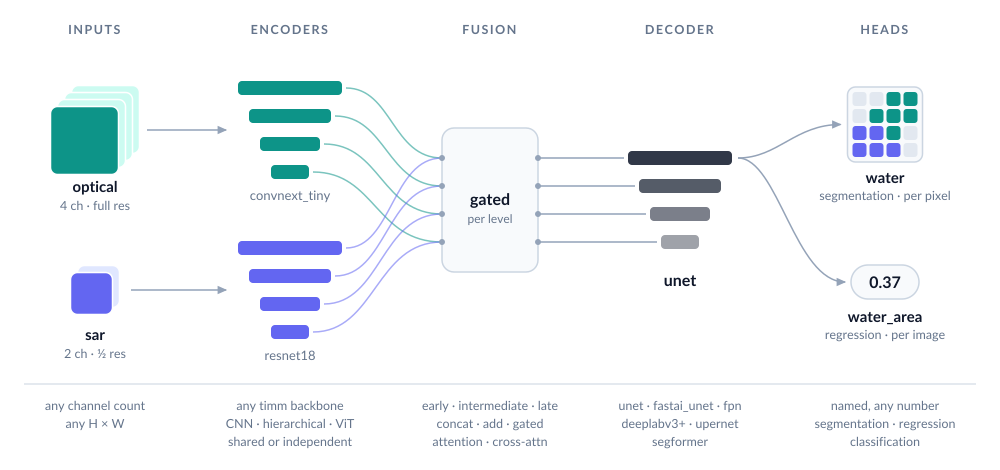
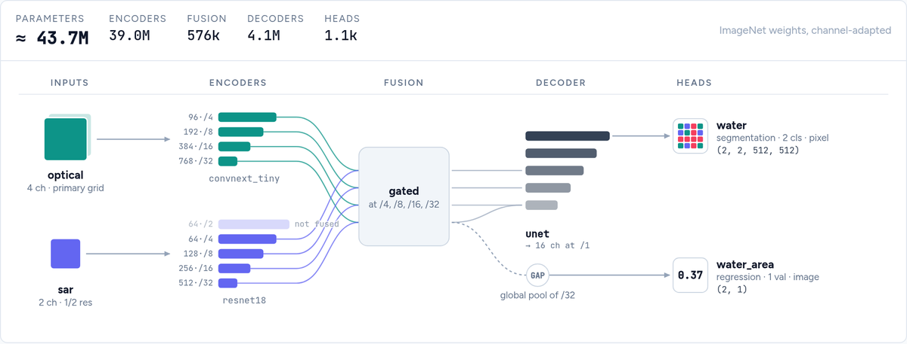

<p align="center">
  <picture>
    <source media="(prefers-color-scheme: dark)" srcset="docs/assets/logo-dark.svg">
    
  </picture>
</p>

<p align="center">
Segmentation and other dense-prediction models for PyTorch, built from
<a href="https://github.com/huggingface/pytorch-image-models">timm</a> encoders.<br>
Any number of bands, several inputs at different resolutions, metadata, and many outputs in one model.<br>
<a href="docs/builder/">Model builder</a>: design a model in your browser and copy the code.
</p>

<p align="center">
  <picture>
    <source media="(prefers-color-scheme: dark)" srcset="docs/assets/architecture-dark.svg">
    
  </picture>
</p>

> **Status: pre-alpha.** The API may still change before the first release.

## Install

ManySeg is not on PyPI yet. Install it from GitHub (Python ≥ 3.10, PyTorch ≥ 2.9):

```bash
pip install "manyseg @ git+https://github.com/DPIRD-DMA/ManySeg#subdirectory=packages/manyseg"
```

Optional extras: `[quant]` (int8 quantisation), `[onnx]` (ONNX export), `[instances]`
(instance post-processing). After the first release this becomes `pip install manyseg`.

## Quick start

```python
import torch
from manyseg import create_model

model = create_model(backbone="convnext_tiny", in_channels=4, num_classes=3)  # U-Net by default
logits = model(torch.randn(2, 4, 257, 301))   # (2, 3, 257, 301): any size, odd or non-square
print(model.describe())                       # what was built, stage by stage
```

`backbone` is a timm model name: ResNet, EfficientNet, ConvNeXt, Swin, PVTv2, ViT, DINOv2 and
most other timm families that expose multi-scale features. 46 families are tested
([compatibility table](docs/backbone_compatibility.md)); a few only accept inputs up to a fixed
size. Pretrained weights are the default (`pretrained=True`): timm downloads them on first use
and they are adapted to your band count. Pass `pretrained=False` to skip the download.

## Model builder

Not sure how to combine inputs, fusion and heads? The [model builder](docs/builder/) draws the
model as you pick options and writes the `create_model` call, refusing combinations ManySeg would
reject. Open `docs/builder/index.html` in a browser; it needs no server.

<a href="docs/builder/"><picture>
  <source media="(prefers-color-scheme: dark)" srcset="docs/assets/builder-dark.png">
  
</picture></a>

## Common tasks

**Multispectral imagery.** Set `in_channels` (e.g. 13 for Sentinel-2). The pretrained RGB stem
is adapted automatically.

**Pick a speed/accuracy trade-off.** Presets are measured configurations:

```python
from manyseg.presets import preset

model = create_model(**preset("balanced"), in_channels=4, num_classes=2)
```

| preset | encoder + decoder | relative speed | accuracy |
|---|---|---|---|
| `fast` | PVTv2-b0 + SegFormer head | 2.4× | slightly below the default on Pet |
| `compact` | PVTv2-b0 + quarter-width U-Net | 2.2× | matches or beats the default |
| `balanced` | PVTv2-b0 + half-width U-Net | 2.1× | matches or beats the default |
| `accurate` | PVTv2-b0 + U-Net | 1.5× | matches or beats the default |

Relative to the default ResNet-34 U-Net, on an RTX 4090 with bf16 + `torch.compile`; accuracy
on two datasets. Validate on your own data.

**Several inputs, possibly at different resolutions**, e.g. optical + radar:

```python
model = create_model(
    inputs={
        "optical": {"in_channels": 4, "backbone": "convnext_tiny"},
        "sar": {"in_channels": 2, "backbone": "resnet18", "alignment": "same_extent"},  # half res OK
    },
    fusion={"type": "intermediate", "op": "concat"},
    num_classes=2,
)
out = model({"optical": optical, "sar": sar})
```

**Several outputs.** Name your heads; the model returns a dict:

```python
model = create_model(
    backbone="resnet50", in_channels=4,
    heads={
        "landcover": {"type": "segmentation", "out_channels": 8},
        "height":    {"type": "regression", "out_channels": 1},                  # per pixel
        "flooded":   {"type": "classification", "out_channels": 2, "scope": "image"},
    },
)
```

**Image classification or regression.** Use only image heads: no decoder is built, and the
model is a classifier that still accepts several inputs, metadata and extra heads.

```python
model = create_model(backbone="resnet50", in_channels=12, heads={
    "labels": {"type": "classification", "out_channels": 19, "scope": "image"}})
```

If you also have pixel labels, training with an extra segmentation head can improve the
classifier. Drop it before deployment with `model.select_heads(["labels"])` (in place: the
model keeps only that head and its output stays a dict).

**Metadata** (acquisition date, sun angle, location, sensor) as extra inputs:

```python
inputs = {
    "image": {"in_channels": 4},
    "meta": {"kind": "vector", "fields": {"doy": {"type": "cyclic", "period": 365.25},
                                          "latlon": {"type": "coords"}}},
}
```

Missing values are handled. In our tests metadata rarely helped, so compare against a model
without it on your data.

**Time series.** One encoder runs on every date and the dates are combined per level (mean,
max, attention, ...); pass `(B, T, C, H, W)` plus optional `"s2_mask"` / `"s2_dates"`:

```python
model = create_model(inputs={"s2": {"kind": "timeseries", "in_channels": 10}}, num_classes=20)
out = model({"s2": torch.randn(2, 6, 10, 128, 128)})        # any number of dates
```

**Change detection.** Two dates through one shared (Siamese) encoder, a difference fusion,
and optionally a land-cover head per date (semantic change):

```python
model = create_model(
    inputs={"t1": {"in_channels": 3},
            "t2": {"in_channels": 3, "backbone": "shared:t1", "share_norm": True}},
    fusion={"type": "intermediate", "op": "diff"},
    heads={"change": {"type": "segmentation", "out_channels": 2},
           "lc1": {"type": "segmentation", "out_channels": 7, "input": "t1"},
           "lc2": {"type": "segmentation", "out_channels": 7, "input": "t2", "share": "lc1"}},
)
```

**Overlapping classes** (e.g. cloud and shadow): one segmentation head with a channel per
class, a sigmoid per channel and BCE loss.

**Embeddings.** `model.features(x)` returns the encoder pyramid; `model.embed(x,
pool="mean")` gives vectors for retrieval, clustering or probing.

**Remote-sensing pretrained weights.** `create_model(backbone="resnet50",
pretrained="ssl4eo_s2_dino", in_channels=13, ...)` loads SSL4EO-S12 or SatlasPretrain weights
(Sentinel-2 / Sentinel-1); see `manyseg.weights` for the band order and normalisation each
expects. Fed their own pretraining normalisation, SSL4EO DINO weights beat the ImageNet
baseline on all three Sentinel-2 datasets we tested (ResNet-50, full fine-tuning; E024).

**Objects and counts.** `manyseg.instances` (touching fields, crowns, buildings) and
`manyseg.points` (trees, animals: centres, counts) provide the heads, training targets and
post-processing.

**Save and load.** `manyseg.save` stores the weights with the configuration and what inference
needs; `manyseg.load` rebuilds the model without downloading anything:

```python
import manyseg

model = manyseg.create_model(in_channels=4, num_classes=2)  # ... then train it
manyseg.save(model, "model.safetensors",
             activations={"logits": "softmax"},             # how each head becomes a prediction
             normalize=[{"type": "scale", "value": 10000}],  # the input scaling you trained with
             classes=["background", "water"])
model = manyseg.load("model.safetensors")
```

**Deployment.** Models work with `torch.compile(dynamic=True)`, `torch.export` and ONNX with
dynamic input sizes (a few encoder families only run at a fixed size or cannot export
dynamically; see the [compatibility table](docs/backbone_compatibility.md)), and with int8
quantisation (`manyseg.quantize`). For fast GPU inference use bf16
autocast plus `torch.compile`.

Most of these have a runnable script in [`examples/`](examples/) that runs on CPU: the numbered
scripts in a few seconds, the walkthroughs that train briefly in 10–20 s.

## Tips from our benchmarks

* **Small batches** (≤ 4 per GPU): keep the encoder's BatchNorm layers in eval mode during
  training (frozen running statistics; their weights still train).
* **Memory-bound?** `decoder_kwargs={"out_stride": 2}` costs no accuracy for the U-Net and
  saves 11–18% memory.
* **Water and other per-pixel spectral targets:** `decoder_kwargs={"input_cross": True}`
  feeds the raw bands to the last decoder stage. It did not help pet or cloud segmentation.
* **Mixed precision is safe:** bf16, fp16 and int8 weight-only showed no accuracy loss.
* **Fusion:** stacking all bands into one input was as good as fancier fusion on the datasets
  we tried; start there.
* **Several dates** beat one by a wide margin. Stacking dates as channels is a strong baseline;
  the time-series input (`"kind": "timeseries"`) beat it on field delineation but not on crop
  types, so try both.
* **Change detection:** a Siamese encoder (shared weights per date) with a difference fusion
  (`"op": "diff"` or `"concat_diff"`) beat stacking the two dates on both datasets we tried.

Every claim here comes from a pre-registered, multi-seed experiment in
[`experiments/`](experiments/), where negative results are kept too.

## Documentation

* [`docs/builder/`](docs/builder/): the model builder, a page where you pick inputs, encoders,
  fusion, decoder and heads and get a live diagram plus the `create_model` code. Open
  `docs/builder/index.html` in a browser; it needs no server.
* [`examples/`](examples/): runnable scripts for each task above.
* [`docs/api_design.md`](docs/api_design.md): the full API (inputs, fusion, decoders, heads,
  metadata, resolution, export, quantisation).
* [`experiments/`](experiments/): the evidence behind the defaults and tips.
* [`CHANGELOG.md`](CHANGELOG.md): what each release contains and what changed.

## Benchmarking (`manyseg-bench`)

A separate package for comparing segmentation libraries (ManySeg, segmentation_models_pytorch,
fastai, timm) under identical data, augmentation and training.
See [`docs/benchmark_design.md`](docs/benchmark_design.md).

## Contributing

```bash
uv sync --all-packages
uv run pytest packages/manyseg -n 4            # fast tests
uv run pytest packages/manyseg -m slow -n 4    # compile, export, ONNX
```

See [`docs/roadmap.md`](docs/roadmap.md) and [`docs/testing_strategy.md`](docs/testing_strategy.md).

## License

MIT. Designs ported from other libraries (e.g. the fastai-style U-Net) cite their source in
the code; see [`docs/architecture_review.md`](docs/architecture_review.md).
