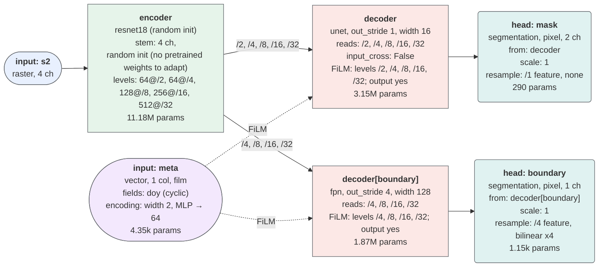

# ManySeg public API design

Status: API for the first release, 0.1.0 (unreleased). Everything below is implemented and
tested, with two exceptions stated where they appear: the `token` conditioning mode raises
`NotImplementedError`, and the large-scene flow through ManyPred needs ManyPred's GitHub main
(not yet in a PyPI release).

## Goals

1. One function, `create_model`, covers the common case, and the objects it builds are ordinary
   `nn.Module`s that can also be composed directly. A `backbone=` given as a module is used
   as is: timm options (`channel_adapter`, `out_indices`, `backbone_kwargs`, a weights tag)
   are errors, `in_channels` must match the module's, and with `inputs=` the one module object
   is shared by every input that doesn't set its own `backbone`.
2. A model's behaviour (inputs, outputs, shapes) is predictable from its construction arguments.
   Nothing about the return type depends on runtime values.
3. Every module in a forward pass is compile- and export-friendly: no tensor-dependent Python
   control flow, no hidden device transfers, no in-forward dictionary mutation keyed on data.
   One exception: in training mode a time-series encoder selects the valid dates, so a partly
   masked batch has a data-dependent shape (see [Time series](#time-series)).
4. The configuration surface stays small. Options are added only when there is a test or an
   experiment that justifies them.

## Layered structure

```
inputs ──► InputAdapter ──► Backbone ──► (Neck) ──┐
                                                  ├─► Fusion ─► Decoder ─► Heads ─► outputs
inputs ──► InputAdapter ──► Backbone ──► (Neck) ──┘
```

| Layer | Contract |
| --- | --- |
| `InputAdapter` | Maps `C_in` channels to what the backbone stem expects. It is either folded into the stem conv (`repeat`, `mean`, `rgb_plus_random`, `rgb_plus_zero`), or it is a small module in front of the stem (`projection`). |
| `Backbone` | `forward(x) -> list[Tensor]`, all NCHW, plus a static `feature_specs: tuple[FeatureSpec, ...]`. Levels the built model never reads may be `None` (pruned ViT neck levels). |
| `Neck` | Optional. Converts single-scale token maps (plain ViT) into a pyramid. Same contract as a backbone. |
| `Fusion` | Combines several pyramids into one (early, intermediate or late; see Multiple inputs). |
| `Decoder` | Constructed from `in_specs`. `forward(list[Tensor]) -> Tensor`. Exposes `out_spec: FeatureSpec`. |
| `Head` | Constructed from a `FeatureSpec`. Maps decoder (or encoder) features to a named output. |

### FeatureSpec

```python
@dataclass(frozen=True)
class FeatureSpec:
    channels: int
    stride: int        # reduction relative to the model input
    name: str = ""     # module name in the backbone, for debugging
```

Feature *tensors* stay plain `list[Tensor]` so that `torch.compile` and `torch.export` never
trace through dataclass construction. The static metadata lives on the module.

All features are returned NCHW. A backbone that produces NHWC (Swin, some hybrids) or token
sequences (ViT) is converted inside the backbone wrapper, so decoders never need to branch on
layout.

## `create_model`

### Single input, single output

```python
from manyseg import create_model

model = create_model(
    backbone="resnet34",      # any timm model name with a supported feature API
    pretrained=True,
    in_channels=4,
    decoder="unet",           # "unet" | "fpn" | ... (registry)
    num_classes=3,
)
logits = model(x)             # x: (N, 4, H, W) -> (N, 3, H, W); returns a Tensor
```

`model(x)` returns logits at the input resolution `(H, W)` for any `H, W` the backbone supports,
including odd and non-square sizes (see "Spatial policy").

### Multiple outputs

Passing `heads=` instead of `num_classes=` makes the model return a `dict[str, Tensor]` keyed by
head name. The return type is fixed when the model is built.

```python
model = create_model(
    backbone="convnext_tiny",
    in_channels=4,
    decoder="unet",
    heads={
        "segmentation": {"type": "segmentation", "out_channels": 3},
        "height":       {"type": "regression", "out_channels": 1},              # per-pixel
        "water_area":   {"type": "regression", "out_channels": 1, "scope": "image"},
        "scene":        {"type": "classification", "out_channels": 10, "scope": "image"},
    },
)
out = model(x)
out["segmentation"]  # (N, 3, H, W)
out["water_area"]    # (N, 1)
```

Heads return raw logits or values: activations and losses live outside the model. Config keys
name directions: an input's bands are `in_channels`, a head's outputs `out_channels`, and a
raw metadata vector's width `num_features`. `scope` is `"pixel"` or `"image"`; it defaults to
`"image"` for `"classification"` heads and `"pixel"` otherwise. `"segmentation"` heads are pixel
heads and `"classification"` heads image heads (the other pairing is an error), while
`"regression"` works for either. Image heads pool the deepest encoder feature by default
(`"source": "decoder"` selects the decoder output). `{"type": "regression", "uncertainty": True}`
returns `2·C` channels, `[mean, log_variance]`, for heteroscedastic losses such as Gaussian NLL.

### Image classification and regression

A model whose heads are all `"scope": "image"` builds **no decoder** (unless a head sets
`"source": "decoder"`): it is an encoder, a
global average pool of the deepest feature (over the unpadded region only, when the input was
padded) and a linear layer per head, i.e. a classifier or
regressor. Everything else composes as for dense models: multiple inputs at different
resolutions, fusion, metadata conditioning (`film` modulates the pooled feature; `head` and
`channels` as usual), uncertainty heads, export and quantisation.

```python
model = create_model(
    inputs={
        "s2_10m": {"in_channels": 4, "backbone": "resnet50"},
        "s2_20m": {"in_channels": 6, "backbone": "resnet50", "alignment": "same_extent"},
        "meta":   {"kind": "vector", "fields": {"doy": {"type": "cyclic", "period": 365.25}}},
    },
    fusion={"type": "intermediate", "op": "concat"},
    heads={
        "crop":    {"type": "classification", "out_channels": 10, "scope": "image"},
        "harvest": {"type": "regression", "out_channels": 1, "scope": "image", "uncertainty": True},
    },
)
out = model({"s2_10m": a, "s2_20m": b, "meta": doy})   # crop (N, 10), harvest (N, 2)
```

For a single RGB/multispectral tensor and one output this builds what
`timm.create_model(backbone, num_classes=K, in_chans=C)` builds for backbones whose timm head is
a pool + linear layer, such as ResNet-50 and PVTv2-b0 (same parameter count): same encoder,
pretrained weights and stem adaptation. Other families differ, because ManySeg always pools the
encoder's last features into a linear layer. ConvNeXt and Swin lose timm's head LayerNorm;
EfficientNet, MobileNetV3, MaxViT and VGG lose the extra layers timm has before the classifier;
plain ViTs go through `ViTPyramidNeck`, so they have more parameters than timm's.

> **Evidence (E019):** on EuroSAT-MS (13 bands) and Pet breeds, with ResNet-50, ConvNeXt-T and
> PVTv2-b0, ManySeg and timm classifiers are at parity on validation accuracy in all six cells.
> On test ManySeg averaged 0.43 points lower (ConvNeXt −0.81, PVTv2-b0 −0.64, ResNet-50 +0.15).
> `{"init_std": 0.02}` in an image head's config uses timm's classifier init; it narrowed the gap
> to 0.27 (E019b), not enough to become the default. What remains is mostly ConvNeXt, whose timm
> head has a pretrained LayerNorm that ManySeg's image head lacks.
>
> **Evidence (E020, BigEarthNet v2, 19-class multi-label, ResNet-50):** parity with timm for
> classification and for class-fraction regression. Resolution band groups, Sentinel-1 (stacked
> or fused) and date + country metadata did not help. A segmentation head on the reference maps
> (U-Net decoder; the classifier still pools the encoder) raised test macro mAP by +2.3 (val
> +2.1), mostly on hard classes. One encoder, a 60k-patch subset and a fixed 12-epoch budget; a
> post-hoc look suggests regularisation (no gain at the classifier's early peak, less late
> overfitting), so the gain may shrink with early stopping. Worth trying when pixel labels exist;
> cost: the decoder's parameters and ~37% lower training throughput.

Mix image and pixel heads freely: the decoder is built only when a pixel
head needs it. After training with auxiliary heads, `model.select_heads(["crop"])` keeps only
the heads you deploy and removes decoders (and FiLM / head-bias layers) only the dropped heads
used; the kept outputs are unchanged in eval mode. `manyseg.save` records the selection and
`manyseg.load` re-applies it; to load a bare state dict instead, rebuild the model and call
`select_heads` with the same names first. Head and input names must not be Python keywords (`yield`, `class`, ...):
`torch.export` reads modules as attributes.

### Multi-label pixel segmentation

For classes that can overlap at a pixel (cloud and cloud shadow, or several land-use layers),
use one segmentation head with `K` channels and treat each as an independent sigmoid; the
model already returns raw logits:

```python
model = create_model(backbone="resnet34", in_channels=13,
                     heads={"masks": {"type": "segmentation", "out_channels": 4}})
logits = model(x)["masks"]                                  # (N, 4, H, W)
loss = F.binary_cross_entropy_with_logits(logits, targets)  # targets (N, 4, H, W) in {0, 1}
present = logits.sigmoid() > 0.5                            # per class, may overlap
```

Mask ignored pixels per class before the loss (the bench task `multilabel_seg` does this with
label 255). Tune the threshold per class on validation if the classes are imbalanced.

### Features and embeddings

```python
feats = model.features(x)                    # encoder pyramid (fused for multi-input),
                                             # each level cropped to the valid region
vec = model.embed(x, pool="mean")            # (N, C) from the deepest level
pix = model.embed(x, source="decoder")       # (N, C, H/s, W/s) decoder features, FiLM applied
unit = model.embed(x, level=2, pool="max", normalize=True)
ep = export_model(model.embedder(pool="mean"), example)   # exportable module
```

For retrieval, clustering, few-shot learning and linear probing. A regression head with `C`
channels is also a (trainable) embedding head. `features()` returns `list[Tensor | None]`:
levels the model never reads are not computed in full. A plain ViT's unread neck levels come
out as `None`, and a multi-input model's unread levels are the primary input's unfused feature.
`embed()` raises a clear error for a `None` level. The deepest level is always computed.

### Remote-sensing pretrained weights

`pretrained` also takes a tag from `manyseg.weights` for supported timm architectures:

```python
from manyseg.weights import WEIGHTS
model = create_model(backbone="resnet50", pretrained="ssl4eo_s2_moco", in_channels=13,
                     num_classes=2)
w = WEIGHTS["resnet50.ssl4eo_s2_moco"]       # bands (order!), mean, std, units, license, source
```

| tags | architectures | input | licence |
|---|---|---|---|
| `ssl4eo_s2_moco` | ResNet-18 / 50, ViT-S/16 | Sentinel-2 L1C, 13 bands, DN / 10000 | CC BY 4.0 |
| `ssl4eo_s2_dino` | ResNet-50, ViT-S/16 | Sentinel-2 L1C, 13 bands, DN / 10000 | CC BY 4.0 |
| `ssl4eo_s1_moco` | ResNet-50 | Sentinel-1 VV/VH dB, band statistics | CC BY 4.0 |
| `satlas_s2_si_ms`, `satlas_s2_mi_ms` | ResNet-50 / 152 | Sentinel-2, 9 bands (RGB as TCI 0–255) | ODC-BY |

Weights download through `torch.hub` (hash-checked, cached); every model parameter must be in
the checkpoint. `in_channels` must equal the weights' band count and the bands must be in the
listed order; normalise with the listed `mean` / `std` (in `units`), and clip to [0, 1] where
`clip` is set, to match pretraining. Bands your data lacks can be filled with the pretraining
mean (0 after normalising). Works per input in multi-input models (`inputs={"s2": {"in_channels":
13, "pretrained": "ssl4eo_s2_moco"}, ...}`).

**Attribution.** The weights are the authors', under the listed licences (CC BY 4.0, ODC-BY),
which require attribution: cite `WEIGHTS[key].citation` (SSL4EO-S12: Wang et al. 2023;
SatlasPretrain: Bastani et al. 2023) in work that uses them. ManySeg's MIT licence does not
cover them. Fine-tuning does not remove the obligation, so the model carries it:
`manyseg.weights.attribution(model)` lists the weights each pretrained backbone started from
(these tags, or timm's ImageNet checkpoints with the licence timm lists) with licence, citation,
source and pretraining normalisation; `manyseg.save` stores the list in the file
(`pretrained_weights`), `manyseg.load` restores it so a re-saved model keeps it, and
`describe()` prints it.

**Pretraining normalisation.** Each record's `normalization` (`{"mean", "std", "units",
"clip"}`) is what the weights were pretrained on: these tags' `WEIGHTS` values, or for timm
checkpoints the weights tag's `pretrained_cfg` (RGB in [0, 1]). The timm statistics are not
always ImageNet's: of the 46 tested backbones' default tags, ViT AugReg
(`vit_small_patch16_224`, `vit_base_patch16_224`), SigLIP, `tf_efficientnetv2_s` and
`coatnet_0_rw_224` use 0.5 / 0.5 and EVA-02 uses CLIP's. The model applies none of it. `manyseg.save` never takes it as a default: without `normalize`
it stores none and warns, and `normalize="weights"` works only for remote-sensing weights tags.
With an adapted stem timm's RGB statistics are not what the bands were trained with, so pass the
normalisation you used.

> **Evidence (E024; Sen1Floods11, BigEarthNet v2, PASTIS; ResNet-50, full fine-tuning after
> one frozen epoch):** with each weight fed its own pretraining normalisation (ImageNet: dataset
> mean / std), `ssl4eo_s2_dino` beat the ImageNet baseline on all three datasets (+2.1 val
> mIoU, +4.1 val macro mAP, +2.1 val mIoU; test +1.4 / +3.7 / +2.1) and `ssl4eo_s2_moco` did
> too, by less (+1.8 / +1.3 / +1.2). For similar Sentinel-2 tasks with a ResNet-50 encoder,
> both are recommended, also on L2A data with missing bands filled. `satlas_s2_si_ms` beat
> ImageNet on Sen1Floods11 only and was slightly worse on PASTIS: not recommended. Untested:
> other architectures, frozen encoders, few labels.

### Multiple inputs

```python
model = create_model(
    inputs={
        "optical": {"in_channels": 4, "backbone": "convnext_tiny", "pretrained": True},
        "sar":     {"in_channels": 2, "backbone": "resnet18",      "pretrained": True,
                    "alignment": "same_extent"},       # may be at a different resolution
    },
    fusion={"type": "intermediate", "op": "gated", "strides": [8, 16, 32]},
    decoder="unet",
    heads={...},
)
out = model({"optical": o, "sar": s})
```

* **Early fusion**: `fusion={"type": "early"}`. Inputs are concatenated on the channel axis
  in front of one shared backbone. Inputs must share spatial size (`same_grid`). Per-input
  encoder keys (`backbone`, `pretrained`, `channel_adapter`, `out_indices`,
  `backbone_kwargs`) must agree across inputs, and they then override the top-level arguments.
  Conflicting values, and a per-input `rgb_indices`, are errors. A fixed-size backbone pads
  the stacked input up to its size and the outputs are cropped back.
* **Intermediate fusion**: each input has its own backbone. Features with the same stride
  are fused by an op (`concat`, `add`, `gated`, `attention`, `cross_attention`, and for
  change detection `diff`, `concat_diff`) whose output has the primary input's channels. Strides that are not selected, or that exist only in the
  primary, pass the primary feature through unchanged. The first raster input in `inputs` is the
  primary. Levels that nothing reads (for example stride 2, which FPN, DeepLabV3+, UPerNet
  and SegFormer skip) are not fused either, so every parameter gets a gradient. For the same
  reason it is an error at construction if an input is never read (for example late fusion
  with only encoder-reading heads), or if an input's deepest levels are (its primary has no
  level there to fuse with; limit that input with `out_indices`). An input that only shares
  a read input's encoder is allowed. Same-grid inputs are all padded to a common multiple
  of their strides, so their features line up level by level.
* **Late fusion**: `fusion={"type": "late", "op": ..., "op_kwargs": ...}`. Each input has its
  own backbone and decoder (same type and options). The decoder outputs are fused before the
  heads, once, at the decoder's output stride, so `strides` is an error here. A
  `same_extent` input's decoder output is resampled by its valid region onto the primary's
  valid region, as in intermediate fusion. A `same_grid` input whose padding differs from the
  primary's (a fixed-size backbone pads to its own size) is cropped or zero-padded onto the
  primary's grid, and resized only when its output stride differs. Image-scope heads read the primary input's deepest
  encoder level.
* Inputs without a `backbone` key use the top-level `backbone=` argument.
* **Shared encoder**: `{"backbone": "shared:optical"}` reuses another input's backbone weights.
  Each input keeps its own input adapter **and its own BatchNorm layers** (affine weights and
  running statistics). One BN shared by inputs with different statistics blends its running
  statistics, and evaluation then applies the blend to every input: in E015 that collapsed a
  shared-encoder model from 0.90 to 0.50–0.65 val mIoU. `"share_norm": True` shares BN too (the
  old behaviour); use it only for inputs with matching statistics (e.g. two dates of the same
  sensor).
* **Shared encoder, different channels**: an input with another channel count than the encoder it
  shares must say how to reach it: `{"backbone": "shared:optical", "channel_adapter":
  "projection"}` puts a learned 1×1 conv in front. Without it `create_model` refuses, so no
  learned layer appears unasked, and giving the input its own encoder is often the better answer.
  Only this input's own setting counts, not the top-level `channel_adapter`. Other adapters are
  refused, as the stem is already built, and so is `"projection"` with equal channels. `"channels"`
  metadata widens its target raster first, which can make a shared input differ.
  E004's verdict on `projection` doesn't settle this case: there the projection was inside the
  encoder's training group, frozen for epoch 1 and then at 0.1× learning rate. A shared input's
  projection is outside `backbone.encoders`, so the benchmark trains it with the decoder.

#### Time series

`{"kind": "timeseries", "in_channels": C, "temporal": ...}` takes `(B, T, C, H, W)`, for any `T`
except with `"concat"` and `"diff"`, which need an exact number of dates.
One 2D encoder (any timm backbone, pretrained weights unchanged) runs on every date, and each
feature level is aggregated over time, so fusion, decoders and heads see an ordinary pyramid.
Optional entries in the input dict: `"<name>_mask"` `(B, T)` bool (False = missing, cloudy or
padded date) and `"<name>_dates"` `(B, T)` days (e.g. day of year).

```python
model = create_model(
    inputs={
        "s2":  {"kind": "timeseries", "in_channels": 10, "temporal": "attention"},
        "dem": {"in_channels": 1, "alignment": "same_extent"},
    },
    heads={"crop": {"type": "segmentation", "out_channels": 20}},
)
out = model({"s2": s2, "s2_mask": valid, "s2_dates": doy, "dem": dem})
```

| `temporal` | aggregation per level |
|---|---|
| `"mean"` (default) | masked mean over valid dates |
| `"max"` | masked per-channel max |
| `"attention"` | per-pixel temporal attention over dates (L-TAE style: learned query, keys from features + a sinusoidal date encoding, `heads` channel groups). Starts as the masked mean (zero query). Options: `heads` (4), `key_dim` (16), `date_dim` (32), `max_period` (10000) |
| `{"type": "concat", "dates": N}` | the features of exactly `N` dates concatenated in date order, then a 1×1 conv-BN-ReLU; a sample with every date masked gets zero features |
| `"diff"` | `\|f_2 - f_1\|` of exactly two dates (bitemporal change); zero where either date is masked |

Time series combine with other rasters (any alignment), metadata vectors and every head type;
fusion must be intermediate or late (early fusion cannot stack a `T` axis). Exports with
dynamic `T`, `H` and `W` (`T` is static for `"concat"` and `"diff"`). The encoder runs once per date, so memory scales with `T`. Masked
dates never affect the output: in training mode only valid dates are encoded (so they stay out
of BatchNorm batch statistics; a partly masked batch has a data-dependent shape, so
`torch.compile(fullgraph=True)` of a training step needs fully valid batches), and NaNs in
masked dates are ignored.
Not yet: `shared:` backbones between a time series and another input, metadata in
`"channels"` mode targeting a time series, and per-input heads (`"input"`) on a time series.

> **Evidence (E021):** several dates beat one by a wide margin (PASTIS +8.6 mIoU, AI4Boundaries
> +5.6 PQ). Stacking all dates as channels in one input is a strong, cheaper baseline: it beat
> the time-series input on PASTIS crop types (by ~4 mIoU), while the time-series input with
> `"attention"` beat stacking on AI4Boundaries field delineation (+2.3 PQ). Attention vs mean
> was within noise on both, so `"mean"` stays the default. Try both on your data.

#### Change detection

> **Evidence (E022):** Siamese encoders with `diff` or `concat_diff` beat stacking both dates in
> one input on OSCD (Sentinel-2) and LEVIR-CD (0.5 m RGB); Siamese `concat` beat it on LEVIR-CD
> only. Neither difference op won on both datasets (`diff` was best on OSCD and worst of the
> Siamese ops on LEVIR-CD), so try both.

Before / after images are two inputs on the same grid. Binary change: one segmentation head on
the fused features; `"op": "diff"` (`|f1 - f2|`) or `"concat_diff"` (`[f1, f2, |f1 - f2|]`) are
the Siamese change fusions, `"share_norm": True` makes the shared encoder fully Siamese, and
stacking both dates in one input (early fusion) is the simple baseline. For a series of dates,
the order-keeping temporal aggregations are `{"type": "concat", "dates": T}` and `"diff"`
(two dates).

**Semantic change** (what changed into what) adds a land-cover head per date. A head with
`"input": "<name>"` reads that input's own (unfused) features through its own decoder
(default: the model's decoder type); `"share": "<head>"` reuses another per-input head's
decoder and head, so both dates are mapped by the same weights (a sharing head may not set a
different `"decoder"`). With one raster input plus
vector (metadata) inputs, `"input": "<the raster>"` likewise gives the head its own decoder;
naming a vector input is an error.

```python
model = create_model(
    backbone="resnet34",
    inputs={"t1": {"in_channels": 3},
            "t2": {"in_channels": 3, "backbone": "shared:t1", "share_norm": True}},
    fusion={"type": "intermediate", "op": "concat_diff"},
    heads={"change": {"type": "segmentation", "out_channels": 2},          # fused features
           "lc1": {"type": "segmentation", "out_channels": 7, "input": "t1"},
           "lc2": {"type": "segmentation", "out_channels": 7, "input": "t2", "share": "lc1"}},
)
out = model({"t1": before, "t2": after})   # change, lc1 (date 1), lc2 (date 2)
```

`lc1` depends only on `t1` (tested), and with `share` `lc2(t1, t2) == lc1(t2, t1)`. Per-input
heads need intermediate fusion and raster (not time-series) inputs.

> **Evidence (E023, SECOND only):** per-input land-cover heads beat land cover from the fused
> features (+1.5 SECOND Score, test +1.5), and sharing them was as good as separate heads with
> fewer parameters, so `"share"` is the recommended setup. A Siamese encoder over stacked dates
> was the bigger step (+7.0).

#### Spatial alignment

Inputs with different pixel sizes are **not** assumed to cover the same ground extent. Each
input declares an alignment policy:

| Policy | Meaning |
| --- | --- |
| `"same_grid"` (default) | Inputs must have identical `(H, W)`. A mismatch raises an error. |
| `"same_extent"` | The input covers the same ground extent as the primary input at a different resolution. At each fused stride, the *valid* (unpadded) region of its features is resampled (bilinear) onto the primary's valid region, so different amounts of padding cannot shift the alignment. Verified by a gradient-centroid test. |

Inputs that are co-registered only partially must be cropped or resampled by the user's data
pipeline. Reprojecting or georeferencing data is outside the scope of a model library.

### Conditioning inputs (metadata vectors)

Non-raster inputs such as acquisition date, sun or view angles, lat/lon, sensor id, GSD or
tabular features are declared as `"kind": "vector"` inputs next to the rasters. They condition
the raster model. They never replace it: a model with only vector inputs is an error.
Pretrained encoders are not modified.

```python
model = create_model(
    backbone="resnet34",
    inputs={
        "s2":   {"in_channels": 13},
        "meta": {"kind": "vector", "fields": {
            "doy":      {"type": "cyclic", "period": 365.25},
            "sun_elev": {"type": "continuous", "mean": 45.0, "std": 15.0},
            "latlon":   {"type": "coords"},                  # (lat, lon) in degrees
            "sensor":   {"type": "categorical", "num": 3},
        }, "dim": 64, "dropout": 0.1, "conditioning": "film"},
    },
    num_classes=2,
)
meta = model.pack_metadata(
    "meta", {"doy": doy, "sun_elev": elev, "latlon": latlon, "sensor": sensor})   # (B, 5)
out = model({"s2": s2, "meta": meta})                   # optional: "meta_mask": (B, 4)
```

`{"kind": "vector", "num_features": N}` declares `N` pre-normalised floats instead of `fields`.

**Input convention.** A vector input is **one packed float tensor `(B, N)`**. Its columns are
the fields in declaration order: `coords` takes two columns (lat, then lon), `categorical`
takes one column holding the id, and every other type takes one column. A dict of per-field
tensors is rejected with a `TypeError`: build the tensor with
`model.pack_metadata(name, {field: values})`, which calls that input's `MetadataEncoder.pack`.
One tensor per vector input keeps the model input a flat `dict[str, Tensor]`: a single ONNX
input whose only dynamic dimension is the batch, and a single array per sample in a data loader.

**Field encodings** (`manyseg.conditioning.FIELD_TYPES`):

| type | options | encoding | width |
| --- | --- | --- | --- |
| `continuous` | `mean`, `std` | `(v - mean) / std` | 1 |
| `cyclic` | `period` | `[sin, cos](2πv / period)`, continuous across the period boundary | 2 |
| `coords` | `frequencies=1` | point `u` on the unit sphere (continuous at the dateline and the poles) plus `frequencies-1` octaves `[sin, cos](2^k π u)`, which keep both properties | 3 + 6(f-1) |
| `categorical` | `num`, `dim=8` | learned embedding; a value that is not an integer, or whose rounded id lies outside `[0, num)`, counts as missing | `dim` |

The encodings are concatenated and mixed by a 2-layer MLP (`Linear-GELU-Linear`) into a
`(B, dim)` embedding.

**Missing values.** A field is missing where the optional `x["<name>_mask"]` `(B, F)` (one
column per field, not per value column, so any other shape is an error; 1 = present) is 0, or where any of its columns is NaN, or where a category
is out of range. A missing field's encoding is replaced by a learned per-field "unknown"
vector, so a model runs with every field missing (for example, all-NaN metadata). With
`"dropout": p`, training drops each field of each sample with probability `p`, so the model
learns the unknown path. All of this is masking with `torch.where`, with no data-dependent
branching, so it compiles and exports.

**Injection modes** (`"conditioning": mode` or `{"mode": mode, **options}` on the vector
input):

| mode | what it does | init |
| --- | --- | --- |
| `film` (default) | FiLM `x·(1+γ(e)) + β(e)` per channel on every encoder feature level the decoder reads (just before it enters the decoder) and on the decoder output. Applied around every decoder: the shared one, per-head task decoders and the late-fusion decoder. `{"on": ["output"]}` limits it to the output. Heads that read the encoder directly (image heads that pool it, including models with no decoder, and pixel heads with `"source": "encoder"`) get one FiLM on the deepest encoder feature; for image heads that is the pooled vector. | exact identity |
| `head` | Image heads: `Linear([pool(f), e])`, implemented as `Linear(pool(f)) + Linear_e(e)`. With `{"pixel": True}`, pixel heads also get the same per-sample term broadcast over space (a 1×1 kernel on the broadcast embedding). | exact identity |
| `channels` | The field encodings (no MLP) are broadcast as extra input channels of one raster input (`{"target": name}`, default the first raster) and go through that input's channel adapter. This is an early-fusion baseline. | depends on the adapter |
| `token` | Metadata as extra ViT tokens. Raises `NotImplementedError`. | n/a |

Why the option sits on the vector input rather than in `fusion=`: `fusion=` describes how
rasters combine. Conditioning is orthogonal to that. It works with a single raster and with
early, intermediate or late fusion, and several vector inputs can use different modes (for
example, `film` for acquisition metadata and `head` for tabular features).

Why FiLM wraps decoders instead of editing them: decoders keep their
`forward(list[Tensor]) -> Tensor` contract, so a FiLM layer can only see what crosses that
boundary. In practice, "each decoder level" means each encoder level the decoder consumes,
plus the decoder output. It does not mean the decoder's internal blocks. The levels a decoder
reads come from its optional `read_levels` attribute. Otherwise they are found once at
construction by a gradient probe (for example, DeepLabV3+ reads only strides 4 and 32), so
every FiLM parameter receives a gradient. The probe takes the union over a square and an odd,
non-square size. It does not touch the global RNG, and it restores every submodule's
train/eval flag and every buffer. Read sets that depend on the input size in other ways are not
supported. Encoders are built after the raster model, so the raster weights match the
unconditioned model's for the same seed. All γ/β projections start at
zero, so a freshly built conditioned model computes exactly what the unconditioned model with
the same weights computes (tested with `rtol=atol=0` for every decoder).

With a single raster input and no `fusion=`, the raster model is the ordinary single-input
model (any decoder works, including `fastai_unet`). With several rasters it is the multi-input
model. `export_model` gives vector inputs and masks no spatial dimensions (only the batch, with
`dynamic_batch=True`).

**Leakage.** In remote sensing, metadata often identifies the scene, event or region (lat/lon
above all). Evaluate conditioned models on splits that hold out whole events or regions. See
`experiments/E009_metadata_conditioning`.

> **Evidence (E009, Sen1Floods11, leave-events-out):** FiLM beat metadata-as-channels (+1.3
> water IoU, 2.9 SE, all folds); FiLM vs no metadata was +0.9 but under the 2 SE bar. Lat/lon added
> nothing on held-out events. **E013 (CloudSEN12+, unseen locations):** FiLM with lat/lon, day of
> year and solar angles was −0.08 val / −0.26 test vs no metadata, and lat/lon added nothing.
> **E016 (PASTIS, single-date crop types):** day-of-year by FiLM was +0.12 val mIoU (bar 0.99),
> the same as a shuffled-date control. Metadata conditioning has now shown no benefit on three
> datasets (flood events, unseen cloud scenes, crop phenology), so treat it as a tool to test on
> your data, not a default. The mechanism itself is verified end to end: a label-deciding metadata
> bit is learned to > 0.95 mIoU through the bench's real training recipe, and a shuffled bit stays
> at chance. The negative results are about the metadata, not the plumbing. Only use `coords` fields with geographic or event-level
> splits; otherwise the model can memorise locations and the evaluation will not show it.
> **Downstream (OmniCloudMask, CloudSEN12, single runs):** per-band presence of zero-filled
> bands by FiLM gained nothing and may have cost a little (see [Missing bands](#missing-bands)).

**Which mode.** `film` and `head` are for information the pixels do not hold: sensor, date,
task, a prompt. FiLM acts on the encoder features the decoder reads, after the encoder has
mixed the bands, so it cannot change how the encoder treats its input. For information about
the input itself (band availability, quality flags), use extra input channels with
`channel_adapter="rgb_plus_zero"`: a raster input for per-pixel masks, `channels` mode for
per-image values. The model then starts exactly as the image-only model (tested). That is the
sensible way to add such information, not a measured gain. If the information is already
visible in the pixels, as a zero-filled band is, it may not help at all.

## Spatial policy

Most CNN encoders need inputs divisible by their total stride (32) so that skip connections
line up exactly. ManySeg handles this explicitly:

* `pad_to_stride=True` (default): the input is padded on the bottom/right to a multiple of the
  required divisor, the network runs, and outputs are cropped back to `(H, W)`. Pixels keep
  their positions, so pixel `(i, j)` of the output corresponds to pixel `(i, j)` of the input.
  The pad value is 0 (applied after the user's normalisation, so 0 is the per-channel mean).
  Models built with several raster inputs always pad each input inside the multi-input
  encoder and always crop the outputs, so there `pad_to_stride=False` has no effect (resizing
  the padded output would stretch the padding into the prediction), and `tiling_spec()`
  reports the padding multiple either way.
  (One raster plus vector inputs builds the ordinary single-input model, where
  `pad_to_stride=False` turns padding off, except for a fixed-size backbone; see below.)
* Decoders resize the upsampled feature to each skip's exact size rather than assuming
  `2×`, so they also work when padding is disabled and a backbone rounds feature sizes up.
* Backbones that only run at one size (MaxViT, CoAtNet, LeViT, EfficientFormerV2, Hiera:
  window partitions or positional tables baked in) are detected at construction by a
  meta-device probe and marked `fixed_size` at their native size, or at `img_size` when
  `backbone_kwargs={"img_size": ...}` is given. Smaller inputs are padded up to it and the
  output is cropped back, whatever `pad_to_stride` says (also for early fusion and for one
  input of a multi-input model). Larger inputs raise a `ValueError` that names the backbone and the
  `img_size` fix. Nothing is ever silently resized.

### Reduced output resolution

Output resolution can be traded for speed and memory in two independent places.

The decoder can also be given as one dict, like a per-head decoder:
`decoder={"type": "unet", "out_stride": 2}` is `decoder="unet", decoder_kwargs={"out_stride": 2}`.

**Decoder `out_stride`** (`decoder_kwargs={"out_stride": s}` or a task decoder's config). The
U-Net family (`unet`, `unetplusplus`, `fastai_unet`) accepts 1 (default), 2, 4, ... (a power of
two below the deepest stride). Stages finer than `s` are not built, so they cost no parameters
or FLOPs, and `out_spec.stride == s`. The reduced decoder is a strict prefix of the default:
every kept module has the same name, shape and computation (state_dict keys are a subset).
`out_stride=1` is the default, so `unet` stays identical to SMP's Unet and `fastai_unet` to
fastai's DynamicUnet (bench parity tests). What is dropped:

| decoder | `out_stride=2` drops | `out_stride=4` also drops |
| --- | --- | --- |
| `unet` | the last block (stride 2 → 1) | the block fusing the stride-2 skip |
| `unetplusplus` | the tail block to stride 1 | the stride-2 row of nested nodes `X[0][*]` (10 → 6 nodes) |
| `fastai_unet` | the final pixel shuffle, the input-image cross and the input-resolution residual block (`last_cross`) | the up-block fusing the stride-2 skip |

Measured cost (ResNet-34, 512², 2 classes, `FlopCounterMode`; total model and change vs
`out_stride=1`). FLOPs understate the saving: the dropped stages are the memory- and
bandwidth-heaviest, so measure latency and memory too (E006).

| decoder | `out_stride=1` | `out_stride=2` | `out_stride=4` |
| --- | --- | --- | --- |
| `unet` | 24.44 M, 62.6 GFLOPs | 24.43 M, 58.9 (−5.9%) | 24.38 M, 52.8 (−15.6%) |
| `unetplusplus` | 25.77 M, 107.3 | 25.77 M, 103.6 (−3.4%) | 25.53 M, 72.1 (−32.8%) |
| `fastai_unet` | 41.22 M, 252.1 | 41.01 M, 154.1 (−38.9%) | 40.63 M, 117.1 (−53.6%) |

For reference, the stride-4 decoders cost 48.0 (`segformer`), 54.9 (`fpn`), 41.6
(`deeplabv3plus`) and 143.9 (`upernet`) GFLOPs.

(For encoders whose shallowest feature is stride 4, `fastai_unet` keeps the final pixel shuffle
at `out_stride=2`: it is the step from stride 4 to 2. See the `fastai_unet` module docstring.)
`fpn`, `deeplabv3plus`, `upernet` and `segformer` have a fixed stride: that of the shallowest
level they read (of at most the 4 deepest levels with stride ≥ 4), so 4 for usual encoders.
They accept `out_stride` only if it equals that stride; anything else is a `ValueError`.

**Choosing a decoder.** Start with `unet`, then try `segformer` (cheaper) and `upernet`
(larger context, more compute) on your own task: their ranking changed between datasets.

> **Evidence (E003, Oxford Pet, ResNet-34, 3 seeds):** `upernet` tied `unet`; `segformer`, `fpn`
> and `deeplabv3plus` were 0.3–1.0 mIoU points behind.
>
> **External data point (OmniCloudMask training on CloudSEN12+, not a pre-registered ManySeg
> experiment; [#4](https://github.com/DPIRD-DMA/ManySeg/issues/4)):** 4 decoders × 5 small
> backbones (EdgeNeXt small and x-small, ConvNeXtV2-femto, EfficientViT-B1, PVTv2-b0), 3 repeats,
> 20 epochs.
> `upernet` led on almost every backbone (mean dice 0.840 vs 0.836 for `unet`), mostly on cloud
> shadow, at about 1.5–3× the GPU cost. `segformer` matched `unet` at lower cost, including on
> thin cloud, and `unetplusplus` added nothing. In a single-run screen on EdgeNeXt-small,
> `fpn` and `deeplabv3plus` were about 0.007 behind, weakest on shadow. In full-length training (35 epochs, 2 seeds, independent test
> sets), a pair of SegFormer models beat a pair of U-Nets at about 0.8× the GPU time, and
> stride-4 logits did no harm at 20 m input.

**`input_cross`** (`unet` only: `decoder_kwargs={"input_cross": True}`, default off). It adds
fastai's full-resolution stage to the SMP-style U-Net: the raw input image is concatenated after
the last block, followed by fastai's residual block (about +7k parameters). It is the stage the
`fastai_unet` decoder calls `last_cross`. It requires
`out_stride=1` and a single raster input.

> **Evidence (E012, Sen1Floods11):** it recovered 83% (ResNet-34) and 81% (PVTv2-b2) of
> fastai_unet's val mIoU gain over `unet`. On test it matched or beat fastai_unet (+2.1 / +1.8
> mIoU over `unet`), at +14% FLOPs against fastai's 4×. On Oxford Pet it did nothing, and on
> CloudSEN12+ cloud masking (E013) it did not replicate (+0.31 val, −0.01 test). Try it when the
> label at a pixel is largely decided by that pixel's own input values at full resolution (a
> spectral threshold or index rule, e.g. water, burnt area, bare soil, snow), and validate it on
> your data. It is not a general improvement, so the default stays SMP-identical.

**Head `scale`** (`{"type": ..., "out_channels": ..., "scale": s}`, pixel heads only; image heads
reject it). `s` ∈ {1, 1/2, 1/4, 1/8}, default 1. With `f = 1/s`, a primary input of `H × W`
gives an output of `ceil(H / f) × ceil(W / f)` (ceil, so every input pixel belongs to exactly
one output pixel; floor would drop the last partial row and column). The head reads a decoder
feature of stride `d`:

* `d == f`: only the head conv runs. Nothing is resampled. This is the saving: a decoder with
  `out_stride=4` feeding a `scale=1/4` head never touches full resolution.
* `d > f`: conv, then bilinear upsampling by `d / f` (as for `scale=1`).
* `d < f`: block-average by `f / d`, then the conv on the coarse grid.

The model crops the head output to the scaled size of the *unpadded* primary input, so
`pad_to_stride` keeps working (with `pad_to_stride=False` on a single-input model it
resizes to that size instead).
Multi-input models use the primary input's grid. Sizes are computed by floor division and
crops are negative padding, so `torch.compile(dynamic=True)`, `torch.export` and ONNX keep
dynamic H/W (tested).

**Alignment.** Output pixel `(i, j)` of a head with `scale = 1/f` covers input pixels
`[i·f, (i+1)·f) × [j·f, (j+1)·f)`. With pixel centres at integer coordinates, its centre is
the input coordinate `(i + 0.5)·f − 0.5` (`manyseg.utils.to_input_coords`; the inverse is
`to_output_coords`). A known-answer test (an area-averaging backbone with an identity head)
checks that the output equals the input's block means, and gradient-centroid tests check
every `out_stride` × `scale`. With `upsample="aligned"` the centroid is within
`1.5 + (out_stride − 1)/2` px of the documented centre. The extra `(out_stride − 1)/2` is the
encoder's own geometry: a "same"-padded strided conv centres feature `k` on input pixel
`k·d`, not on its block centre (E001). Default nearest upsampling keeps its known up-left
bias (about 6 px at init) at every stride.

**Targets and predictions at head scale** (`manyseg.utils`, outside the model graph):

| helper | for | rule |
| --- | --- | --- |
| `downsample_labels(y, s, ignore_index, mode="mode")` | class ids | majority per block; ignored pixels and padding never vote; all-ignored block → `ignore_index`; ties → lowest id. `mode="nearest"` takes the block-centre pixel. Pass `num_classes` to avoid device syncs. |
| `downsample_mean(x, s, valid=None)` | continuous targets | mean over each block's in-image (and `valid`) pixels; `valid` is `(B, H, W)`, `(B, 1, H, W)` or `(B, C, H, W)` |
| `downsample_sum(x, s)` | density targets | block sums, so the count is preserved |
| `downsample_max(x, s)` | heatmaps, thin boundaries | block maximum: keeps peaks; "any" for boolean maps |
| `upsample_output(y, (H, W), s, mode)` | predictions | bilinear (logits, values) or nearest (labels, any dtype), cropped to `H × W` |

Instance and point post-processing runs on the grid it is given. `find_peaks(hm, scale=s)`
returns float input-pixel coordinates. `group_by_offsets` and `instances_from_outputs` return
head-grid labels; map them back with `upsample_output(labels, (H, W), s, mode="nearest")`.
`manyseg-bench` computes losses on each head's own grid and compares at input resolution.
Native targets are built according to what each target means:

* semantic labels and instance extent: majority vote;
* boundaries: any;
* distance: mean over instance pixels;
* heatmaps: max;
* offsets: mean divided by `f`;
* density: sum;
* point validity: the fraction of valid pixels in each block.

For metrics, semantic and instance predictions are upsampled to input resolution, points are
picked on the native heatmap and returned in input-pixel coordinates, and counts integrate the
native density. Native-scale semantic metrics are optional (`native_metrics=True`). See the
`manyseg_bench.tasks` module docstring.

## Input channel adaptation

```python
create_model(backbone="resnet34", pretrained=True, in_channels=13, channel_adapter="repeat",
             num_classes=2)
```

| `channel_adapter` | Behaviour on the pretrained stem conv `W ∈ R^{O×3×k×k}` |
| --- | --- |
| `"repeat"` (default; timm-compatible) | Cycle the RGB filters to `C` channels and scale by `3/C` (`C = 1` sums them). A constant input keeps its response only when `C` is 1 or a multiple of 3; use `"mean"` for that at any `C`. |
| `"mean"` | Every channel gets `mean_c(W)·3/C`, so a constant input keeps its response. |
| `"rgb_plus_random"` | The first 3 channels keep `W` unchanged. The others are drawn from `N(0, (std(W)/2)²)`. |
| `"rgb_plus_zero"` | The first 3 channels keep `W`. The others are zero, so the model is initially identical to RGB-only. |
| `"projection"` | A learned 1×1 conv `C→3` in front of the unchanged stem. RGB-identity initialisation when `C ≥ 3`. |

`in_channels=3` with a pretrained backbone leaves the weights untouched for every adapter.

> **Evidence (E004, 13-band Sentinel-2):** no adapter beat `repeat`, which stays the default;
> `projection` was harmful, in a run that froze it for epoch 1 and then trained it at 0.1×
> learning rate, so a normally trained projection may do better.

**Channels that are not image bands.** `repeat` and `mean` treat every input channel as a
band. Take RGB plus three 0/1 validity masks (`in_channels=6`): `repeat` gives each mask a copy
of an RGB filter and halves the filters on the image channels. Masks are 1 almost everywhere,
so at init they add a near-constant offset to the stem output, and the image signal is halved.
For masks, quality flags and other channels that are not image bands, `rgb_plus_zero` starts
as the exact RGB model and the extra channels learn from zero weights. If the RGB bands are not
channels 0–2, pass `rgb_indices` in that input's config (`inputs={"s2": {..., "rgb_indices":
[3, 2, 1]}}`; not with early fusion) or in `backbone_kwargs` (top-level or per input; a
per-input `rgb_indices` wins over a top-level one); it is not a `create_model` argument. `describe()` lists which pretrained filter each input
channel starts from. Training does recover from the perturbation: in the OmniCloudMask runs
(see [Missing bands](#missing-bands)), mask channels under `repeat` ended within noise of no
mask channels. `rgb_plus_zero` was not compared there, so treat it as the safer start, not a
measured gain.

### Missing bands

A model has a fixed band list. If a band can be missing at inference, fill it at inference the
same way you filled it in training, and make it go missing in training too. The OmniCloudMask
project (cloud and shadow masking of Sentinel-2, Landsat 8 and PlanetScope: R, G, NIR, per-image
z-score normalisation) sets a missing band to 0 after normalisation. In training, it zeroes
whole bands at random: 20% of images lose one band and 10% lose two. With that recipe, zero
filling alone handled missing bands. Two extra signals added nothing clear (CloudSEN12 val mean
dice, ManySeg U-Net, one run per arm; run-to-run noise about ±0.003; reported by that project, not
reproduced in this repo):

| bands present | edgenext_small: zero-fill | + mask channels | + presence FiLM | convnextv2_femto: zero-fill | + mask channels |
|---|---|---|---|---|---|
| R+G+NIR | 0.8537 | 0.8532 | 0.8500 | 0.8524 | 0.8533 |
| R+G | 0.8461 | 0.8470 | 0.8386 | 0.8439 | 0.8449 |
| R+NIR | 0.8431 | 0.8422 | 0.8363 | 0.8404 | 0.8401 |
| G+NIR | 0.8478 | 0.8477 | 0.8443 | 0.8469 | 0.8490 |
| R only | 0.8240 | 0.8219 | 0.8212 | 0.8156 | 0.8185 |
| G only | 0.8332 | 0.8335 | 0.8310 | 0.8317 | 0.8336 |
| NIR only | 0.7668 | 0.7676 | 0.7700 | 0.7593 | 0.7650 |

"Mask channels" adds the per-pixel valid mask (`x != 0`) per band as three extra input channels
(`in_channels=6`, `repeat`). "Presence FiLM" adds the fraction of valid pixels per band as a
`film` vector input. Mask channels gained at most a little (femto, single-band cases). FiLM
gained nothing and may have cost a little on edgenext (−0.003 to −0.008 with two bands). The
model can see a zero-filled band in the pixels, so telling it again is redundant. These are
single downstream runs, not a pre-registered experiment. Other fills, such as copying a
neighbouring band, were not tested; they may work as well if training uses the same fill.

## Lower-level composition

```python
from manyseg.backbones import create_backbone
from manyseg.decoders import UNetDecoder
from manyseg.heads import PixelHead
from manyseg.models import DenseModel

bb = create_backbone("resnet34", pretrained=True, in_channels=4)
dec = UNetDecoder(bb.feature_specs)
model = DenseModel(bb, dec, {"mask": PixelHead(dec.out_spec, 3)}, single_output="mask")
```

`create_model` is argument parsing over this composition (plus fusion, conditioning and the
pruning of unread levels). In `create_model`, `backbone` also accepts a module (with
`feature_specs` and `input_divisor`) and `decoder` a decoder class or callable; heads, fusion
and conditioning are configured by dicts only.

### Instance and point outputs

> **Evidence:** E010 (AI4Boundaries): boundary + distance heads doubled PQ over extent +
> connected components (0.145 → 0.290), and per-head decoders (`decoders="separate"`) added
> +0.06 more, so they are the recommended preset for field delineation. E011 (OAM-TCD): MSE
> focal-loss heatmaps were no better than MSE regression on val (within noise) and worse on
> test, so MSE stays the default. Calibrate the `find_peaks` threshold on
> validation data: E011b raised test point F1 from 0.40 (fixed 0.5) to 0.59 (val-chosen 0.15–0.2,
> since MSE peaks rarely reach 1). With calibrated peaks, counting peaks (MAE 20.6) is close to
> the density head (19.4 raw; 19.8 with the softplus default, E011c). The density head stays
> slightly better for counting and needs no threshold, **for many small objects per tile**
> (OAM-TCD trees, σ = 2 px). A downstream drone-imagery project (not reproduced in this repo; one
> seed, 45 validation images) found the opposite with a few large plants per tile (1–20 per
> 792 px tile, about 115 px across): peak counting on a separately decoded heatmap was far better
> (count MAE 1.0 vs 7.5–11 for raw density heads), because a background bias of about 0.01 per
> pixel, summed over 600k pixels, adds phantom objects. A Gaussian blur before NMS
> (`smooth_sigma=3`) and a foreground mask were its biggest peak-counting gains, and calibrated
> thresholds differed between folds and did not beat a fixed 0.3. A softplus density output
> brought the density head's count MAE there to 2.9, from 7.5 for the raw head summed as
> `count_from_density` does (10.1 clamped at 0); a background floor remains, about +1.75 objects
> per image (2.4 on an empty 792 x 792 tile).
> Details of that run: clamped at 0, the raw head had a mean signed error of +10.1, equal to its
> MAE, so it over-counted on every image; its correlation was 0.80;
> softplus had correlation 0.72, and starts at about 12 objects per
> tile from its -4 bias. A ReLU output died: its bias drifted to -0.005, the largest count on any
> image was 0.06 against true counts up to 27 (MAE 3.5, correlation 0.37), and it was removed.
> Softplus is the default since E011c found it no
> worse on OAM-TCD (test MAE 19.8 vs 19.3 raw, within the margin); `density_head(activation=None)`
> keeps the raw head.


Dense instance-style outputs are built from ordinary pixel heads, optionally with per-head
task decoders. There are no proposal- or query-based methods. Presets return head configs:

```python
from manyseg.instances import instance_heads, instance_targets, instances_from_outputs
from manyseg.points import (point_heads, density_head, find_peaks, count_from_density,
                            calibrate_threshold)

# Field / paddock / crown / footprint delineation (ResUNet-a / FracTAL style)
model = create_model(backbone="convnext_tiny", in_channels=4,
                     heads=instance_heads(decoders={"boundary": "unet"}))
t = instance_targets(instance_ids, boundary_width=2)     # torch, runs on the GPU
out = model(x)
labels = instances_from_outputs(out["extent"], out["boundary"], out["distance"], logits=True)

# Counting / locating trees, livestock, dams, sheds
model = create_model(backbone="resnet34", heads={**point_heads(offsets=True), **density_head()})
out = model(x)
thr, curve = calibrate_threshold(val_heatmaps, val_points, metric="f1")  # E011b: ~0.15-0.2
peaks = find_peaks(out["heatmap"], threshold=thr, smooth_sigma=0, mask=None)
count = count_from_density(out["density"], sigma=3.0)  # the density_loss sigma (or value_scale=)
```

| Preset | Heads | Targets (`manyseg.*.targets`) | Post-processing |
| --- | --- | --- | --- |
| `instance_heads(num_classes=1, decoders=None)` | `extent` (1 ch, or C+1 with background; `instance_losses` trains C+1 with cross-entropy + multiclass Dice against `instance_targets(semantic=...)`), `boundary` (1), `distance` (1, regression) | `instance_targets(ids, boundary_width=1, boundary_mode="inner"/"outer"/"both")`: exact EDT; distance is 1 + distance to the instance's edge, normalised per instance; tile borders are not boundaries | seeds = extent ∧ ¬boundary ∧ distance > t; every component gets at least one seed; `backend="auto"` (default): skimage watershed when scikit-image is installed (`manyseg[instances]`), else seeded growth in torch |
| `point_heads(heatmap="regression"/"segmentation", offsets=False)` | `heatmap` (1), `offset` (2: dy, dx) | `gaussian_heatmap(points, size, sigma)`, `heatmap_from_instances` (centroids rounded to pixels; fixed or size-scaled σ), `offset_targets` (to exact centroids), `points_from_boxes` (YOLO / `xyxy` / COCO `xywh` → `(y, x)`, optional σ from box size) | `find_peaks` (max-pool NMS; optional `smooth_sigma` blur and `mask`), `calibrate_threshold`, `group_by_offsets` → instance ids, `panoptic_labels` |
| `density_head(activation="softplus"/None)` | `density` (1; > 0 with softplus, the default since E011c) | `density_map(points, size, sigma)`: each point's Gaussian sums to exactly 1 inside the image; `density_loss` (target × 2πσ², valid mask, optional count L1) | `count_from_density(sigma= or value_scale=, mask=)`: exactly one, as given to `density_loss` (count = integral / 2πσ²) |

`decoders=None` shares the model decoder. `"separate"` gives each head its own `unet`. A name or
`{head: decoder}` mapping chooses decoders per head. Post-processing (peak picking, seeded
growth or watershed, grouping) is **not part of the exported graph**: export the model, then
run the post-processing functions on its outputs. Losses are in `manyseg.losses`. Object metrics
(PQ, object F1, over-/under-segmentation, point F1, count MAE) and task-aware training live in
`manyseg-bench` (`manyseg_bench.evaluation.objects`, `manyseg_bench.tasks`).

### Vector outputs (line graphs, polygons)

**Experimental in 0.1.0.** Names and defaults may still change, and each decoder was chosen on
one or two datasets. They need the `vectors` extra (`manyseg[vectors]`: shapely, networkx,
rasterio, scipy, scikit-image); writing GeoPackages also needs geopandas.

**Recommended API** (`manyseg.vectors` unless noted):

* Head presets: `corner_line_heads()`, `road_heads()`; `manyseg.instances.instance_heads()`,
  `manyseg.points.point_heads()` / `density_head()`.
* Target encoders: `to_pixels` (labels in a CRS → tile pixels), then `footprint_targets`,
  `field_targets`, `roof_face_targets`, `road_graph` → `road_targets`; for points
  `manyseg.points.points_from_xy` → `gaussian_heatmap` / `density_map`.
* Decoding: `decode_scene(fields, block_decoder(task), scene=Scene(H, W, transform, crs))` with
  `task` one of `"footprints"`, `"fields"`, `"roofs"`, `"roads"`, `"points"`, `"density"`. This
  is both the whole-scene and the large-scene path: with the default `block=4096` a scene of up
  to 4096 px a side is one block, a larger one is decoded block by block. `block_decoder` holds
  the tuned settings.
* Results and writers: `SceneRecords` (footprints, fields, roofs: a list of dicts carrying the
  scene's transform and CRS, with `.write(path)` and `.to_geojson()`), `VectorGraph` (roads; carries the scene's transform and CRS, with `.write(path)` and `.to_geojson()`),
  `manyseg.points.ScenePoints` (`.yx`, `.xy`, `.scores`, `.to_geojson()`) and
  `manyseg.points.SceneCount`; `write_records`, `records_to_geojson`, `to_geojson`.
* Georeferencing helpers: `Scene`, `from_gdal`, `pixel_to_world`, `world_to_pixel`;
  `manyseg.points.points_to_xy` / `points_from_xy`.

**Building blocks** (generic defaults; `block_decoder(task)` has the tuned ones):
`polygons_from_corners`, `polygons_from_labels`, `graph_from_road_heads`, `graph_from_mask`,
`graph_from_mask_blocks` (a plain line-probability head over a large scene), `planar_faces`,
`bridge_ends` (modifies its graph in place), `graph_chains`, `corner_targets`,
`rasterize_instances`, the dihedral augmentation (`dihedral`, `dihedral_xy`,
`dihedral_geometry`, `dihedral_shape`), the block machinery (`block_grid`, `Block`,
`BlockDecoder`, `InstanceBlockDecoder`, `RoofBlockDecoder`, `RoadBlockDecoder`,
`manyseg.points.PointBlockDecoder` / `DensityBlockDecoder`) and roof assembly in
`manyseg.vectors.roofs` (`roof_faces`, `roof_records`, `face_plane`, `roof_planes`,
`roof_mesh`; not re-exported).

A model predicts dense heads; a decoder turns them into polygons, graphs or points outside the
model, so export and inference stay plain tensors. The workflow per task is the same:

1. **Targets.** Your vector labels in any CRS → `to_pixels` (cut to a tile, reprojected) → the
   task's target encoder → one numpy array per head.
2. **Model.** `create_model(heads=...)` with the task's head preset, trained with the task's
   loss terms: `corner_line_losses`, `road_losses` or `manyseg.instances.instance_losses`.
3. **Decoding.** The predicted rasters (sigmoid applied to logit heads, or `logits=True`) →
   `decode_scene(fields, block_decoder(task), scene=scene)` → `SceneRecords`, a `VectorGraph`
   or `ScenePoints` in scene pixels, block by block for scenes of any size.
4. **Output.** `records.write(path)` / `write_records` (GeoJSON, or GeoPackage via geopandas)
   through the scene's geotransform and CRS.

| Task | Heads | Targets | Decoder | Reads |
| --- | --- | --- | --- | --- |
| Building footprints | `corner_line_heads()` | `footprint_targets` | `block_decoder("footprints")`: instances → `polygons_from_corners` (straight exterior walls; courtyards kept as traced outlines, E054) | `extent`, `boundary`, `distance`, `corner`, `direction` |
| Field boundaries | `instance_heads()` | `field_targets` | `block_decoder("fields")`: instances → `polygons_from_labels` (pixel outlines) | `extent`, `boundary`, `distance` |
| Road networks | `road_heads()` | `road_graph` → `road_targets` | `block_decoder("roads")`: `graph_from_road_heads` | `mask`, `keypoints`, `direction` |
| LoD2 roof faces | `corner_line_heads()`, RGB + nDSM input | `roof_face_targets` | `block_decoder("roofs")`: faces → `planar_faces` → a plane per face → mesh | as footprints + `height` (the nDSM) |
| Points, counts | `point_heads()`, `density_head()` | `to_pixels(kind="points")` → `points_from_xy` → `gaussian_heatmap` / `density_map` | `PointBlockDecoder`, `DensityBlockDecoder` (also `block_decoder("points")` / `("density")`) | `heatmap` (+ `offset`, `mask`); `density` |

Logit heads, to pass through a sigmoid before decoding: `extent`, `boundary`, `corner`, `mask`,
`keypoints` (and `heatmap` with `point_heads(heatmap="segmentation")`). `distance`, `direction`,
`offset` and `density` are values; `height` is the nDSM you fed the model, not a prediction.
Or pass raw logits with `block_decoder(task, logits=True)`: footprints, fields and roofs apply
the sigmoid to `extent`, `boundary` and `corner`, roads to `mask` and `keypoints`, points to
`heatmap` and the optional `mask` field; values are never transformed.

Why these decoders (pre-registered experiments in [`experiments/`](../experiments/)):

Experiment write-ups name decoders by their arm: **B0** instance outlines, **B3** corners and
walls, **R0** mask skeleton, **R4** unified road heads, **F0** / **F3** roof faces from outlines /
from corners and walls, **J1** / **J2** the `mean_height` / `plane_intersection` mesh joins.

* **Footprints, E038** (WHU aerial, 2 seeds): corners and walls beat pixel outlines on
  boundary F (+0.02) and C-IoU × F1 (0.63 vs 0.46-0.47), at 0.01-0.02 lower detection F1.
* **Fields, E046** (Fields of The World, Netherlands, 1 seed): pixel outlines beat corners
  and walls on boundary F (0.59 vs 0.57), as in the E045 oracle (touching fields snapped to
  each other's corners, curved edges were straightened). **E052** (2 seeds): an absolute
  distance target (px) is as good as the normalised one (boundary F +0.008, detection F1
  +0.008). With perfect targets, stitched large scenes change no fields at seams under
  `merge="cut"` and at most one under blending (3-34 and 8-30 for the normalised target), so it
  is the fields default.
* **Seed fragments, E053** (fixed decoder settings, trained models): dropping seed components
  under 8 px (`min_seed`) raised roof face F1 by 0.041, footprint detection F1 by 0.024 and
  field detection F1 by 0.008 with boundary F unchanged or better; default in `block_decoder`.
* **Roads, E044 / E044b** (City-Scale, 3 seeds): `graph_from_road_heads` matched a mask
  skeleton (APLS +0.003 to +0.005, junction F1 +0.02 to +0.03) and kept 22-25 points more of
  the overpasses (0.54-0.59 vs 0.32-0.34).
* **Roof faces, E047b + E048b** (3D BAG, Netherlands, 1 seed): trained faces on RGB + nDSM
  reached face F1 0.57-0.59 against 0.28-0.31 for plane segmentation of the nDSM, with lower
  height error (1.3-1.4 m vs 1.8-2.1 m RMSE). The shipped corner decoder gives straight outlines
  (C-IoU 0.64 vs 0.15-0.21 for pixel outlines) at 0.01-0.04 lower face F1, so E047b's rule did
  not prefer it over pixel outlines; it ships because E048b's face joining and meshes were built
  and tested on it (straight shared edges; 2,957-3,353 shared mesh vertices after planar joining and the `plane_intersection` mesh, about 4x
  fewer than pixel outlines' 10,690-13,075). Joining faces decoded with corners and walls into a planar partition raised
  their seam closure from 0.38 to 0.71-0.73 (3D BAG's own faces: 0.79). That catches up with pixel
  outlines rather than beating them: those reach 0.68-0.73 with the mesh join alone, with lower vertex
  height error (0.40-0.52 m vs 0.48-0.61 m).
  **E049:** from RGB alone, with predicted heights, face F1 fell by 0.28-0.38 and height RMSE
  rose by 1.8-2.9 m: not viable.
* **Stitching, E050 / E050b**: decode stitched predictions made with `merge="cut"` (each pixel
  from the most central tile) and tiles of at least 1024 px with 256 px overlap. Cutting removed
  the seam effect on road junctions (agreement with a single-pass prediction +0.017 over
  blending; E050's rule met for roads). For roofs E050's rule was not met at 512 / 128 px tiles
  (best cut arm -0.001, the shipped midline cut -0.002); E050b showed tile context mattered most (face agreement with the single pass
  0.944 at 512 / 128 px, 0.987 at 1024 / 256 px, both cut). At 1024 / 256 px the cut also beat
  blending on roofs (+0.008), but that comparison was not pre-registered.

**One scene, end to end.** Coordinates are pixel `(x, y)` with pixel corners at integers, so
an affine geotransform in rasterio order (`dataset.transform`; GDAL's through `from_gdal`) maps
them to the CRS directly:

```python
from manyseg.vectors import (Scene, block_decoder, decode_scene, footprint_targets,
                             to_pixels, write_records)

# Training targets for one tile: vector labels in a CRS -> pixels -> every head's target
# crs: the labels' CRS (a GeoDataFrame's own .crs is used if omitted); raster_crs: the image's
polys = to_pixels(buildings, transform, (H, W), crs=buildings_crs, raster_crs=crs)  # reprojected
targets = footprint_targets(polys, (H, W))  # instances, corner, direction, extent, ...

# A predicted scene -> polygons in the CRS. `pred`: head name -> stitched (C, H, W) or (H, W)
# numpy arrays (or memmaps), sigmoid applied to the logit heads
scene = Scene(H, W, transform=transform, crs=crs)
dec = block_decoder("footprints")  # or "fields", "roads", "roofs"; parameters override defaults
records = decode_scene(pred, dec, scene=scene)  # SceneRecords: dicts by id + transform, crs
records.write("buildings.geojson")  # ".gpkg" with geopandas; = write_records(records, path)
```

`decode_scene` cuts the scene into blocks (cores that partition it, plus a `halo` of context;
defaults `block=4096`, `halo=256`, so a smaller scene is one block) and joins the objects that
cross block edges. The halo must be at least the decoder's `min_halo`, and the result equals a
whole-scene decode when the halo also covers how far decoding reaches in that data, which
`min_halo` does not bound (see the limitations below; equality tested on seams, block corners,
several grids and real stitched predictions). Footprints, fields and roofs return `SceneRecords`: a list of dicts, carrying the
scene's `transform` and `crs` for `.write(path)` / `.to_geojson()`, with
`id` (the scene pixel index of the object's first pixel, so it does not depend on the grid),
`geometry` (shapely, scene pixels), `pixels` and `scene_edge` (touches the scene edge, so it
may be cut). Roof records hold `id`, `part` (pieces a join split off), `geometry`, `plane`
(`z = a x + b y + c` in metres, `x` / `y` in scene pixels) and `mesh` (a `(K, 3)` ring;
`write_records(..., mesh=True)` writes 3-D polygons, z in metres).
`"roads"` returns a `VectorGraph` carrying the scene's `transform` and `crs` (`graph.write(path)`
/ `graph.to_geojson()`, as for `SceneRecords`); points return
`ScenePoints` (`to_geojson()`). Runnable
versions of each task: [`examples/14_vector_footprints.py`](../examples/14_vector_footprints.py)
to [`18_vector_points.py`](../examples/18_vector_points.py).

**Large scenes with ManyPred** (*needs ManyPred's GitHub main for `merge="cut"` and
`BlockPostprocess`; they are not yet in a PyPI release*). ManyPred stitches the tiles' outputs
and calls the decoder on each block of the stitched rasters while it predicts, so one call
writes the vectors. Memory stays bounded when `load_func` returns a lazy reader, as here, with the default
GeoTIFF writer and no `postprocess=`: it then holds a strip of block rows plus `2 * halo` rows per
field. `load_raster` reads the whole scene, and such scenes are stitched in memory. Return
`(reader, reader.profile)`, not the reader alone, or the outputs lose their transform and CRS.
`.gpkg` needs geopandas, which `manyseg[vectors]` does not install.

```python
from pathlib import Path

from manypred import BlockPostprocess, predict_files
from manypred.geo import RasterioReader
from manyseg.vectors import block_decoder, write_records

def load(item):
    reader = RasterioReader(item)
    return reader, reader.profile

dec = block_decoder("footprints")
post = BlockPostprocess(
    dec, block=4096, halo=256, combine=dec.combine,
    save=lambda records, item, scene: write_records(records, Path(item).with_suffix(".gpkg"), scene),
    fields=["extent", "boundary", "distance", "corner", "direction"],
)
predict_files(
    model, ["scene_1.tif", "scene_2.tif"], load_func=load,
    patch_size=1024, overlap=256, merge="cut",  # E050b: tiles >= 1024 px, 256 px overlap
    activation={"extent": "sigmoid", "boundary": "sigmoid", "corner": "sigmoid"},
    block_postprocess=post,
)
```

The decoder sees only model outputs there, so for roofs either have the model return its nDSM
input as a `height` output, or decode the saved rasters afterwards with
`manypred.postprocess_blocks({..., "height": "ndsm.tif"}, dec, combine=dec.combine)` (fields
may be raster paths, read window by window). Without ManyPred, `decode_scene` does the same
over arrays or memmaps you stitched yourself.

**Limitations.**

* Experimental: decoders and defaults come from one or two datasets each (above); validate
  on your data, and re-tune thresholds there (`block_decoder(task, extent_threshold=...)`).
* Roofs need a height input (nDSM in metres, on the image grid): planes are fitted to it, and
  without it the face partition collapses (E049).
* Fields: with the 3 px seed threshold (absolute distance, E052) a strip of a field narrower
  than about 8 px has broken seeds, so the field can split along it, even from perfect targets.
* Roofs: the acute tip of a hip-end face, cut off by two walls' boundary bands, can be flooded
  from a neighbouring face's seed, so the face loses its tip (single-pass face IoU down to 0.75
  on synthetic scenes). Seed fragments under `min_seed` (8 px, E053) no longer become extra
  faces.
* Distance target: fields use absolute distance (E052). Footprints and roof faces keep the
  normalised one (as trained in E038 / E047; absolute is not tested there), whose per-tile
  normalisation can reshape roof faces in tile overlaps under ManyPred's `merge="blend"`:
  stitch roof predictions with `merge="cut"`.
* The halo must be at least the decoder's `min_halo`: 17 px for footprints and 30 px for roofs
  (corner decoding), 2 px for fields, 29 px for roads, `kernel // 2` plus the blur radius for
  points, 0 for density. `decode_scene` raises below it. 256 px is the default. `min_halo` is necessary, not sufficient
  for equality with a whole-scene decode (next two points).
* Roads: skeletonisation can reach further than the
  other steps, about the half-width of the widest road blob and up to ~3 times that for blobs
  with holes (car parks). If that exceeds the halo, the graph near a seam may differ from a
  whole-scene decode; `combine` warns when a block's skeleton changed with its halo. Use a
  larger halo then.
* Instances equal a whole-scene decode when each window labels an instance as the whole scene
  would, which holds when the decoder's reach stays below the halo. Where windows disagree
  beyond that (an instance much larger than the halo), an object may split at a seam, but no
  pixel is lost or claimed twice. This depends on the predictions: on noise-like field outputs
  (400 px scene, `block=100`), halos of 2 to 64 px gave 209-239 objects against 241 for a
  whole-scene decode, while E051's trained roof scene matched exactly. Compare on your own
  outputs if an exact match matters.

#### Building blocks

> **Evidence:** E028 (oracle: perfect OSM roads and footprints rasterized into each candidate set
> of targets, corrupted, decoded, scored). Roads: a road mask → skeleton is the baseline to beat.
> A Sat2Graph-style graph tensor decodes perfect targets best and is the only one that keeps
> overpasses, but missed vertices and occlusion break it faster than a mask, so it is not offered
> for roads; a junction heatmap adds nothing. Footprints: the same graph tensor → faces gave the
> best oracle polygons through moderate corruption (C-IoU 0.72–0.75 vs 0.53 for mask contours) and
> fails all-or-nothing. Trained on WHU aerial (E030, one seed) it fell well below mask instances
> (C-IoU 0.61 vs 0.71, detection F1 0.75 vs 0.85), so it is not shipped: as pre-registered, the
> code stays in `experiments/E030_whu_polygons/graph_tensor.py`.

These are the steps `block_decoder` composes, for use on their own (one tile, a custom
pipeline). Their defaults are generic; the tuned settings are in `block_decoder(task)`
(footprints E038, E053, E054; fields E046, E052, E053; roofs E047b, E053; `graph_from_road_heads` shares the roads ones,
E044). Decoding runs outside the exported model. Coordinates are `(x, y)` in GIS raster convention
(pixel corners at integers), unlike `manyseg.points` (`(y, x)`, centres at integers), so a
geotransform maps them directly (`to_geojson(..., transform=)`). Needs `manyseg[vectors]`.

```python
import torch
from manyseg.instances import instances_from_outputs
from manyseg.vectors import graph_from_mask, polygons_from_labels, to_geojson

# Roads, tracks, fences: one line-probability head
g = graph_from_mask(torch.sigmoid(out["roads"])[0, 0], threshold=0.5, gap=25)  # VectorGraph
fc = to_geojson(g, transform=geotransform)        # LineStrings, world coordinates

# Footprints, fields: instance heads -> exact pixel-edge polygons
labels = instances_from_outputs(out["extent"], out["boundary"], out["distance"], logits=True)[0]
polys = polygons_from_labels(labels, simplify=1.0)   # shapely Polygons, holes kept

```

Metrics (APLS, GEO precision / recall, junction F1, grade-separated crossings, C-IoU, PoLiS,
N-ratio) are in `manyseg.vectors.metrics`: `graph_metrics(gt, pred, gsd)` and
`polygon_metrics(gt, pred, gsd)` return them together.

**Training presets.** Two trained models have head presets, target encoders and the experiments'
losses, as plain functions that return the unweighted terms (`sum(parts.values())` is the trained
models' loss). `manyseg-bench` has training tasks that call them. Both use built-in head types; the focal-loss heatmap heads start at
`p = 0.1` (`bias_init = logit(0.1)`).

| Preset | Heads | Targets | Losses, and the bench task (`manyseg_bench.tasks`) | Decoding |
| --- | --- | --- | --- | --- |
| `corner_line_heads()`: footprints, roof faces (E036, E038, E047) | `extent`, `boundary`, `distance` (as `instance_heads`), `corner` (1), `direction` (2: `cos 2t`, `sin 2t`) | `instance_targets(ids, boundary_width=2)` + `corner_targets(polygons, shape)` | `corner_line_losses`; `CornerLineTask` (`"corner_lines"`): instance loss + CenterNet focal (corner) + masked L1 (direction on outlines); PQ | `instances_from_outputs` → `polygons_from_corners` |
| `road_heads()`: roads (E039, E044) | `mask` (1), `line` (1), `keypoints` (3: junction, end, crossing), `direction` (4: two modes) | `road_targets(graph, shape, crossings=, width=6)` | `road_losses`; `RoadGraphTask` (`"roads"`): Dice + BCE (mask, line) + focal over the keypoints (positives floored at 16) + L1 (mode 1 on roads, mode 2 where two road chains overlap at an angle: crossings and junctions); mask IoU | `graph_from_road_heads` |

Targets carry pixel widths, sigmas and angles, so augment them only with the 8 exact dihedral
transforms (`manyseg.vectors.dihedral(a, d, direction=True)` for the direction fields: a quarter
turn negates `(cos 2t, sin 2t)`, a flip negates `sin 2t`, a transpose `cos 2t`;
`dihedral_geometry` / `dihedral_xy` move the polygons or graph to match). Re-encoding transformed
geometry gives the same targets except where a pixel centre lies exactly on an edge
(rasterisation breaks that tie by direction), so augment the encoded targets. The bench does this
itself for these tasks (`GPULoader(dihedral=True, directions=...)`), from a dataset cache whose
labels are a dict of target arrays (`{split}_masks.{name}.npy`). Example:
[`examples/vector_presets.py`](../examples/vector_presets.py).

**From your vector data to training targets.** Vector labels in a CRS (OSM roads, cadastre
footprints, field parcels, LoD2 roof faces) become one tile's targets in two calls:
`to_pixels` cuts them to the tile in pixel coordinates, an encoder returns every head's target
as numpy arrays under the preset's head names.

```python
import rasterio
from manyseg.vectors import footprint_targets, road_graph, road_targets, to_pixels

with rasterio.open("tile.tif") as src:              # or a GDAL geotransform via from_gdal(gt)
    transform, shape, crs = src.transform, src.shape, src.crs

# Footprints (fields, roof faces alike): GeoDataFrame, GeoJSON features or shapely geometries
polys = to_pixels(buildings_gdf, transform, shape, raster_crs=crs)   # reprojected if needed
t = footprint_targets(polys, shape)  # instances, corner, direction, direction_mask, extent, ...

# Roads: ways that share a vertex meet at a junction; a crossing without one is an overpass
lines, src_idx = to_pixels(roads_gdf, transform, shape, raster_crs=crs, return_index=True)
g, crossings = road_graph(lines, widths=roads_gdf["width_m"].to_numpy()[src_idx] / 0.5)
t = road_targets(g, shape, crossings=crossings)     # mask, line, keypoints, direction
```

| Task | Encoder | Returns | Trained with |
| --- | --- | --- | --- |
| Footprints (E036, E038) | `footprint_targets(polygons, shape)` | `instances`, `corner`, `direction`, `direction_mask` (what `CornerLineTask` reads) + `extent`, `boundary`, `distance` (`instance_targets`, `boundary_width=2`; `instance_heads=False` drops them, the task derives them itself) | `CornerLineTask` |
| Roof faces (E047) | `roof_face_targets(faces, shape)` | as footprints; faces sharing an edge stay separate instances. Heights are not a target: the nDSM is an input channel and planes are fitted after decoding | `CornerLineTask` |
| Fields (E046, E052) | `field_targets(polygons, shape)` | `instances`, `extent`, `boundary`, `distance`: 4-connected pieces as instances, pieces < 16 px dropped, holes holding only background filled (a hole around another field stays) | `InstanceTask(boundary_width=2, distance="absolute")` |
| Roads (E044) | `road_graph(lines)` → `road_targets(graph, shape, crossings=)` | `mask`, `line`, `keypoints`, `direction` | `RoadGraphTask` |

Pixel coordinates are `(x, y)` with pixel corners at integers, the inverse of `to_geojson`'s
transform (`pixel_to_world` / `world_to_pixel` convert arrays and geometries; Z is kept). `to_pixels` makes
polygons valid, clips them to `[0, W] x [0, H]` and splits multipart geometry; lines are clipped
with their vertices kept, so junction vertices still match. A building cut by the tile edge is
clipped there, as the experiments trained. Where polygons overlap, the later one wins (rasterio
order; the covered walls and corners of the earlier one are not drawn either);
`rasterize_instances` exposes that step (`fill_holes`, `split`, `min_area`). Reprojection
needs both CRSs: `to_pixels` raises when only one of the features' CRS (`crs=` or a
GeoDataFrame's `.crs`) and `raster_crs` is known, unless `assume_same_crs=True`; with neither
known the features are taken to be in the raster's CRS. Unit tests
encode synthetic vectors and decode the targets with the shipped decoders
(`polygons_from_corners`, `polygons_from_labels`, `graph_from_road_heads`). They assert mean IoU
above 0.96 for footprints (each above 0.93, at least 90% with the same vertex count), mean above
0.93 for roof faces (each above 0.88), each field above 0.95, and roads within 3 px with both
junctions kept and the overpass left uncrossed.

**Points (trees, animals, wells) in a CRS and over large scenes.** `manyseg.points` works in
`(y, x)` with pixel centres at integers; `manyseg.vectors` in `(x, y)` with pixel corners at
integers. Convert only with `points_to_xy` (`xy = yx[:, ::-1] + 0.5`) and `points_from_xy`, its
inverse: a swap or a half-pixel shift survives any round trip within one convention.
`to_geojson` refuses torch tensors for that reason.

```python
from manyseg.points import find_peaks, gaussian_heatmap, points_from_xy, points_to_xy
from manyseg.vectors import block_decoder, decode_scene, to_geojson, to_pixels

# Training targets from labelled points in a CRS
xy = to_pixels(trees_gdf, transform, shape, raster_crs=crs, kind="points")  # (N, 2), in the tile
hm = gaussian_heatmap([points_from_xy(xy)], shape, sigma=2.0)               # (1, 1, H, W)

# One tile: peaks -> GeoJSON Points with scores
# point_heads() defaults to a regression heatmap: no sigmoid (a sigmoid makes background 0.5)
((yx, scores),) = find_peaks(out["heatmap"], threshold=0.3)
fc = to_geojson(points_to_xy(yx), transform, properties={"score": scores.numpy()})

# A stitched scene, block by block (halo >= dec.min_halo = kernel // 2 + blur radius)
dec = block_decoder("points", threshold=0.3, kernel=5, smooth_sigma=1.0, offsets="offset")
pts = decode_scene(fields, dec, scene=scene)  # ScenePoints; ManyPred: postprocess_blocks
fc = pts.to_geojson()  # through scene.transform, names scene.crs (transform=None: pixels)
# pts.yx (y, x, centres at integers), pts.xy (x, y, corners at integers), pts.scores
```

`PointBlockDecoder` runs `find_peaks` on each window and keeps the peaks whose pixel lies in the
block's core; with a halo of at least `min_halo` it equals a whole-scene `find_peaks` exactly (same
peaks, scores and plateaus; tested on seams, corners, scene edges and several grids) and raises
when a block's halo is smaller on a side that is not the scene edge. Offsets (`dy, dx`) are added
at the peak, so a refined point may sit just outside its core. Results are sorted by score, ties
in raster order; `max_points` applies to the whole scene. `DensityBlockDecoder(sigma= or value_scale=)`
sums a density field over each core and divides by the training target's scale (`2πσ²` for
`density_loss`'s default; exactly one is required, as for `count_from_density`) (`SceneCount`:
total and per-block counts; no halo needed).
`manyseg.vectors.block_decoder("points", **params)` and `block_decoder("density", **params)` build
these two decoders. `ScenePoints.to_geojson()` reserves the `score` property (a user
`properties["score"]` raises).
`to_pixels(kind="points")` keeps `0 <= x < W`, `0 <= y < H`, so a point on a shared tile edge
goes to one tile (within float rounding of the edge it can go either way).

## Inspecting a built model

`model.describe()` (or `manyseg.describe.describe(model)`) summarises the model stage by stage:
inputs and channel adapters, encoders (backbone, pretrained or random, feature levels), fusion
(type, op, fused strides, shared or independent encoders), metadata conditioning (fields, FiLM
targets, head bias), decoders (type, `out_stride`, width, levels read, `input_cross`) and heads
(type, channels, scope, scale, uncertainty, and the decoder that feeds each one), with
parameters per stage. It reads the constructed modules, not the `create_model` arguments, so it
shows what was actually built.

```python
print(model.describe())                       # indented text tree
print(model.describe(sample))                 # + real shapes at each stage boundary and FLOPs
mermaid = model.describe(format="mermaid")    # flowchart string
dot = model.describe(format="dot")            # Graphviz string

from manyseg.describe import model_graph, render_dot
render_dot(dot, "model.png")                  # needs the Graphviz `dot` binary on PATH
g = model_graph(model)                        # nodes and edges, for programmatic checks
```

With a `sample` (a tensor or dict, as for `model(sample)`), one `no_grad` forward pass in eval
mode records the padded encoder inputs, each encoder level, the fusion inputs (a `same_extent`
input shows up already resampled onto the primary grid), each decoder output, and each head's
raw and cropped output. Train/eval flags are restored afterwards. All three formats are plain
strings and need no extra dependencies. This model has a 4-channel raster, a FiLM metadata
vector and an FPN decoder of its own for one head:

```python
create_model(backbone="resnet18", pretrained=False, inputs={
    "s2": {"in_channels": 4},
    "meta": {"kind": "vector", "fields": {"doy": {"type": "cyclic", "period": 365.25}}}},
    heads={"mask": {"type": "segmentation", "out_channels": 2},
           "boundary": {"type": "segmentation", "out_channels": 1, "decoder": "fpn"}})
```



## Export

```python
from manyseg.export import export_model
ep = export_model(model, example)            # dynamic H/W in [stride + 1, 4096] (*)
ep = export_model(model, example, dynamic_batch=True)   # example batch must be >= 2
ep = export_model(swin_model, example, dynamic=False)   # fixed H/W (window attention)
ep = export_model(multi_input_model, {"optical": o, "sar": s})
ep = export_model(conditioned_model, {"s2": s2, "meta": meta})   # meta: (B, N), no H/W dims
```

(*) `stride` is the deepest stride the network computes. When inputs are padded to less than
that (`pad_to_stride=False`, or a multi-input model using only shallow levels), the range
starts at `2 * stride` instead: floor-rounding layers (a 4x4 / stride 4 patchify, PVT's
spatial-reduction attention) need two cells there. A same_extent input always gets its own
H/W symbols, and a time series whose aggregation needs an exact date count (`concat`, `diff`)
keeps T static.

`export_model` builds the `dynamic_shapes` spec itself and uses deferred runtime asserts. Some
timm blocks produce guards that are always true but that the export solver cannot prove.
Window-attention backbones (Swin, Swin V2, DaViT) cannot be exported with dynamic H/W, so
`export_model` refuses them up front; `dynamic=False` exports at the example's fixed H/W (add
`dynamic_batch=True` to keep the batch dynamic), with the same meaning as for `quantize_pt2e`
and `dynamic_shapes`. See
`backbone_compatibility.md`. For ONNX, pass the same spec to the dynamo exporter:
`torch.onnx.export(model, (x,), path, dynamo=True,
dynamic_shapes=manyseg.export.dynamic_shapes(model, x))` (see `examples/06_export.py`; the
parity check needs `onnxruntime`, which the `onnx` extra does not install).

### Distributed training

DDP needs nothing from ManySeg: wrap the model as usual. Models are built so that every
parameter gets a gradient (no `find_unused_parameters=True` needed): modules for feature
levels nothing reads (fusers, learned temporal aggregations, ViT neck levels, and the timm
EfficientNet / MobileNetV3 blocks past the last requested level) are not built, and the random
configuration fuzzer checks this. Heads you leave out of the loss still need it, or
`select_heads` (which prunes again what only the dropped heads read). DDP needs nothing from
ManySeg: wrap the model as usual. BatchNorm statistics stay per rank, unless you convert to
`SyncBatchNorm`.

### Small batches

> **Evidence (E007, E007b; Pet and Sen1Floods11):** at batch 2, keeping the pretrained encoder's
> BatchNorm in eval mode (statistics frozen, affine weights still training) gave +0.8 (Pet)
> and +2.3 (Sen1Floods11) val mIoU at matched optimiser steps. Gradient accumulation alone did
> not help, because BN still sees micro-batches. Batch 2 × accumulate 8 with frozen encoder BN
> came within 0.2 mIoU of batch 16 on Pet and beat it on Sen1Floods11.

When memory forces batches of about 1–4, freeze the encoder's BN statistics after every
`model.train()`:

```python
model.train()
bb = model.backbone
encoders = bb.encoders.values() if hasattr(bb, "encoders") else [bb]  # early fusion: one encoder
for enc in encoders:
    while hasattr(enc, "backbone"):         # time-series and early-fusion encoders wrap the
        enc = enc.backbone                  # timm backbone
    for m in enc.model.modules():           # the pretrained timm network only: a ViT's neck and
        if isinstance(m, torch.nn.modules.batchnorm._BatchNorm):  # the fusion layers are new
            m.eval()                        # running stats fixed; weights and biases still train
```

### Speed: compile and precision

> **Evidence (E014, idle RTX 4090, 512², 2 encoders × 5 decoders):** bf16 autocast was ≥ 1.3×
> faster than fp32 in 9 of 10 pairs (median 1.61×, inference batch 8). `torch.compile` on top
> gave a median 1.46× in bf16 (≥ 1.2× in 10/10) and only 1.22× in fp32. For training steps,
> compile gained only a median 1.17× and was sometimes slower. A cold compile cost 8–15 s per
> inference shape and 28–54 s per training shape.

Recommended for inference: `torch.autocast("cuda", torch.bfloat16)` +
`torch.compile(model, dynamic=True)` (one graph across input sizes; see the spatial policy).
At batch 1 in eager mode, fp32 can beat bf16 because cast overhead dominates small decoders;
compiling removes that. For training, use bf16 autocast; compile is optional.

**Training with variable input sizes** (random rescaling or crops, so the batch shape changes
every step). PyTorch's CUDA caching allocator keeps blocks for each size it has seen, so the
memory it reserves (what `nvidia-smi` shows) can grow well past the peak the model allocates,
and allocations then fail and retry once the GPU fills. On a shared GPU the cache also blocks
other jobs. Set `PYTORCH_CUDA_ALLOC_CONF=expandable_segments:True` before CUDA initialises,
compare `torch.cuda.max_memory_reserved()` with `max_memory_allocated()`, and compile with
`dynamic=True` so new sizes do not each trigger a recompile.

> **External data point (OmniCloudMask training, ConvNeXtV2-femto U-Net, batch 40, bf16, inputs
> 36–565 px; [#3](https://github.com/DPIRD-DMA/ManySeg/issues/3)):** peak allocated memory was
> 11.9 GiB while `nvidia-smi` showed 21 GB reserved. Allocator OOM-retry warnings appeared in
> 12 of 12 runs without `expandable_segments` and in 0 of 69 (shorter) runs with it.

## Quantisation

`quantize_pt2e` and `quantize_weights` need torchao (`pip install 'manyseg[quant]'`,
BSD-3-Clause). Without it, they raise an `ImportError` that names the extra. `model_size` and
`compare_outputs` work without torchao. In torch 2.14, PT2E moved out of `torch.ao` into
torchao, so both quantisation routes use it.

```python
from manyseg.quantize import compare_outputs, model_size, quantize_pt2e, quantize_weights

# Static int8 for CPU (PT2E): export -> prepare -> calibrate -> convert -> export.
ep = quantize_pt2e(model, example, calibration)         # calibration: iterable of inputs
ep = quantize_pt2e(multi_input_model, {"optical": o, "sar": s}, dict_batches)
ep = quantize_pt2e(swin_model, example, batches, dynamic=False)   # fixed size only
manyseg.save(ep, "model_int8.pt2", source=model, normalize=spec, activations=activations)
program = manyseg.load("model_int8.pt2")                # callable with tiling_spec()

torch._inductor.config.freezing = True
fast = torch.compile(ep.module())                       # oneDNN int8 kernels

# int8 weights on the eager module (CPU or GPU), no calibration.
q = quantize_weights(model)                             # "int8_weight_only" (default)
q = quantize_weights(model, "int8_dynamic")             # + int8 activations in Linear layers
manyseg.save(q, "model_int8.safetensors", normalize=spec, activations=activations)
q = manyseg.load("model_int8.safetensors")              # nn.Module with int8 weights

model_size(ep), model_size(q)                           # serialized bytes
compare_outputs(model, ep, test_batches)   # nn.Module arguments run in eval mode, then get their mode back
# {"max_abs_diff": ..., "mean_abs_diff": ..., "argmax_agreement": ...}
# argmax only for float (B, C) / (B, C, H, W); integer outputs get "exact_agreement";
# "dtype_changed" (and a warning) if the dtype differs; dict outputs: "seg/argmax_agreement"
```

`quantize_pt2e` returns an `ExportedProgram`, like `export_model`. H/W stay dynamic, and the
batch too with `dynamic_batch=True`; with `dynamic=False`, `dynamic_batch=True` gives a dynamic
batch at the example's fixed H/W. The default quantizer is torchao's
`X86InductorQuantizer`, with per-channel int8 weights and per-tensor uint8 activations. Pass
`quantizer=` to target another backend; `reduce_range` configures only the default quantizer
and is an error together with `quantizer=`. Calling `ep.module()` eagerly runs the int8 graph as
quantise/dequantise pairs in float. That shows the accuracy cost, but it is about twice as
slow as float. The speedup only appears after `torch.compile` with inductor freezing.

> **Evidence (E008, trained ResNet-34 U-Nets, Pet and Sen1Floods11, 3 seeds):** bf16 and fp16
> cost nothing measurable. `quantize_weights` costs ≤ 0.05 mIoU. Compiled PT2E int8 costs
> 0.10–0.13 mIoU with ≥ 99.5% pixel agreement. On CPUs **without VNNI** (e.g. AMD Zen 3),
> inductor's u8 × s8 kernels saturate unless activations use a reduced range, and compiled int8
> silently lost 6.5 mIoU on Pet. `quantize_pt2e` therefore defaults to `reduce_range` when the
> *current* CPU lacks VNNI. If you quantise on one machine and deploy on another, pass
> `reduce_range=` for the deployment CPU (`True` is always safe; `False` is about 0.1 mIoU
> better only where VNNI exists). Always measure `compare_outputs` on the compiled module you
> deploy, not only on `ep.module()`.

A full-range program (`reduce_range=False`, the default on VNNI CPUs) warns when it is made, and
records the choice in the program (it survives `torch.export.save` / `load`). In the deployment
script, `manyseg.quantize.check_deployment(ep)` raises if this CPU cannot run that program
correctly. Window-attention backbones (Swin, Swin V2, DaViT) are rejected before a dynamic
export (`dynamic=False` quantises at the example's fixed size; add `dynamic_batch=True` to keep
the batch dynamic), because their dynamic export
fails inside timm (it used to hang).

**Saved files.** `manyseg.save` keeps the metadata and `tiling_spec()` for both routes, and
loading needs `manyseg[quant]`. Quantised files use save format 2 like float files; a
`quantization` entry in the metadata marks them.

* A `quantize_weights` file is safetensors: each int8 weight as its plain `qdata`, `scale` and
  `zero_point` tensors. `load` rebuilds the model, quantises it with the stored `mode` and `conv`,
  and puts those tensors back.
* A `quantize_pt2e` file is a `.pt2` archive with the metadata inside and no sample inputs, the one
  part `torch.export.save` always pickles. `save` needs `source=`, the float model, and refuses a
  program it can't write, such as a dynamic-size ViT (use `dynamic=False`). A program loaded
  back (the `QuantizedProgram` or its `.program`) can be saved again, also with `source=`.
* `load` on a `.pt2` returns a `QuantizedProgram`, not an `nn.Module`, because `ep.module()` raises
  on `.eval()`. It has `__call__`, `tiling_spec()`, `program`, `module`, `device`, `batch_size`
  (None if dynamic), `fixed_size` (None if dynamic) and `input_shapes`. `map_location` sets its
  device, and a wrong device, batch size or fixed size raises an error naming the fix.
* `torch.export.load` can run code from a crafted file, through pickled entries and through shape
  strings passed to `sympy.sympify`. `load` checks for both first, but this is no sandbox: only
  load `.pt2` files from sources you trust.
* In ManyPred, pass `device="cpu"` for a program loaded on the CPU, and the program's `batch_size`
  if it has one. Patches are square, so a non-square fixed size can only be called directly.
  `torch.compile` gives int8 kernels only with `torch._inductor.config.freezing = True`.

`quantize_weights` stores Linear and Conv2d weights as int8, symmetric per output channel.
Depthwise convs stay float, because torchao rejects their weights and they are tiny anyway.
Conv weights are dequantised on the fly, so a CNN gets about 4x smaller but no faster. torchao
has no dynamic-activation conv, so `"int8_dynamic"` differs from weight-only only in Linear
layers. For a ResNet U-Net the two modes are identical. `conv=False` quantises Linear layers
only; a model without any (a plain CNN) is returned unchanged, with a warning, and saves as a
float file. A float or `quantize_weights` model always saves as `.safetensors`: `save` refuses a
`.pt2` path for it. The model is copied unless `inplace=True`.

Measured once on CPU (4 threads, shared machine, so the timings are contended; no record under
`experiments/`): a ResNet-34 U-Net (ImageNet encoder, random decoder, 6 classes) at 256², with
16 calibration batches.

| | Size | Max / mean abs diff | Argmax agreement | Latency |
| --- | --- | --- | --- | --- |
| float | 99.5 MB (exported) | | | 56 ms eager, 37 ms compiled |
| `quantize_pt2e` | 26.5 MB (0.27x) | 1.94 / 0.12 | 0.961 (0.965 at 255×199) | 109 ms eager, 19 ms compiled |
| `quantize_weights` | 25.1 MB (0.26x of the state dict) | 0.61 / 0.06 | 0.980 | 66 ms eager |

A random decoder gives near-flat logits, so these agreement numbers are pessimistic. Check a
trained model on your own validation data.

## Registries

Decoders, heads, fusion ops and metadata field types register by name in a plain `dict`-backed
registry. Channel adapters are a fixed list. Backbones do not need one, because timm's model registry is used as is.
Compatibility with a given timm model is discovered by probing (see
`architecture_review.md`), not from hand-maintained allow-lists.

## Non-goals

* Training loops. These live in `manyseg-bench` (in this repository; it is not published on
  PyPI) or in user code; `manyseg.losses` provides the
  losses.
* Data loading and general augmentation. `manyseg.vectors` has only what vector targets need:
  dihedral transforms and coordinate and CRS conversion for labels and outputs.
* A config-file DSL. Plain keyword arguments and dicts are enough, and they serialise to
  YAML or JSON if a user wants files.
