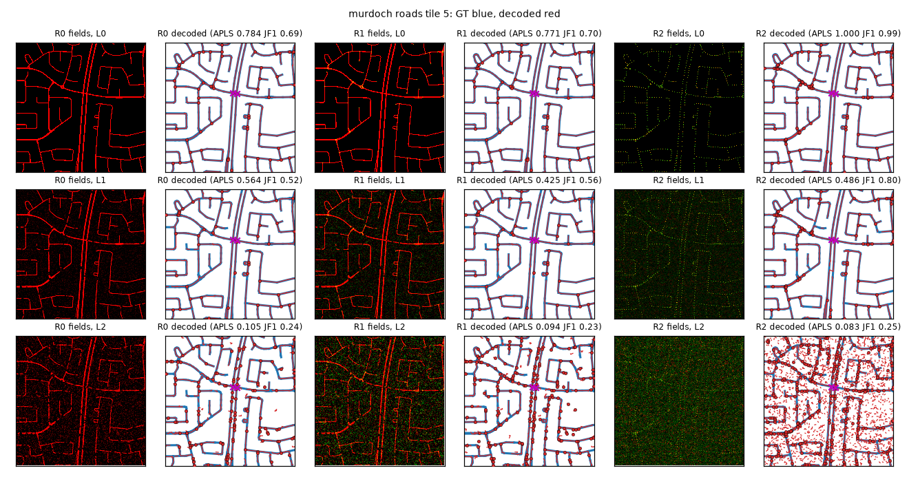
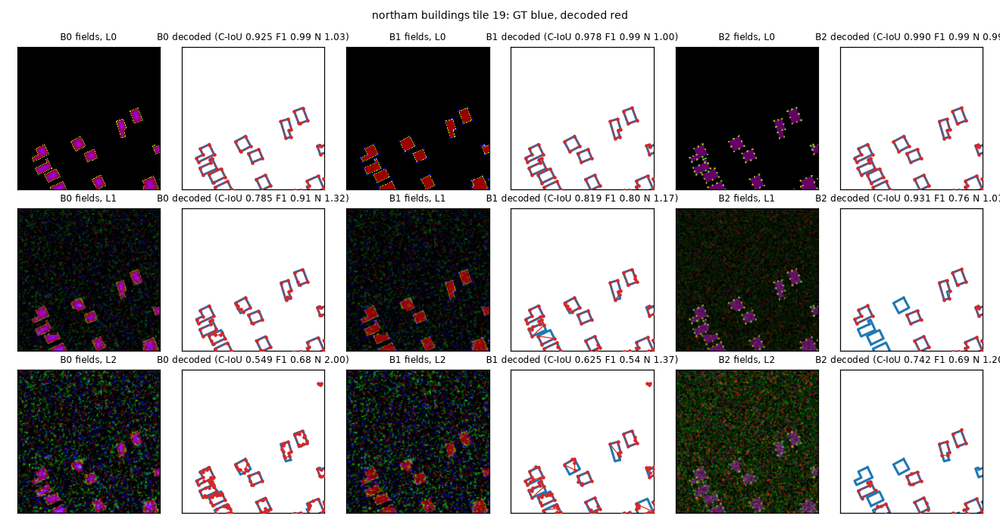

# E028: Oracle decodability of vector representations (roads, footprints) (pre-registered)

Status: **complete** (2026-10-26; CPU only, no model trained; code `f7b46ba`, test run 115 min on 8 processes). **Oracle results (decoding of synthetically corrupted perfect targets, not trained models). Roads: the graph tensor (R2) has the best ceiling and is the only representation that keeps overpasses, but it fails the pre-registered inclusion rule: missed vertices and occlusion break it faster than a mask. Junction (R1) and corner (B1) heatmaps fail too. Footprints: the same graph tensor (B2) passes the viability rule and has the best oracle-decoded polygon metrics through level 2.**

Background: the vector-output proposal (roads and lines as graphs, building footprints as
polygons, later LoD1/LoD2 buildings) and its Codex review. The review's main point was that the
planar graph works as a shared *output format*, but probably not as one learned representation
and decoder for every task. The cheapest test is an oracle: rasterize perfect ground-truth
vectors into each candidate set of dense targets, corrupt them in controlled ways, decode, and
score. If a representation cannot be decoded well from perfect or mildly corrupted fields, there
is no point training a model to predict it.

## Questions
1. **Roads.** Under the same corruptions, does a Sat2Graph-style graph tensor (vertexness plus,
   per angular sector, edge probability and a vector to the neighbouring vertex) decode to better
   road graphs than a road mask → skeleton, or a mask plus junction heatmap?
2. **Footprints.** Does a corner heatmap improve polygons over instance masks (ManySeg's
   boundary + distance heads) → contour → simplify?
3. **Unification.** Can the *same* graph tensor and decoder that is used for roads also produce
   footprints (closed rings → faces, labelled by the building mask) about as well as the
   dedicated footprint pipelines?

## Data
OpenStreetMap (© OpenStreetMap contributors, ODbL), fetched 2026-10-26 by `fetch_osm.py`, stored
outside the repo and not redistributed. Three ~3 × 3 km areas in Western Australia, in GDA2020 /
MGA 50:

| area | role | roads (ways) | buildings |
|---|---|---|---|
| innaloo | tune (decoder parameters) | 886 | 179 |
| murdoch | test | 1032 | 1068 |
| northam | test (regional town) | 235 | 1160 |

* Roads: drivable public classes (motorway … residential, links, living_street; no service roads
  or tracks; tunnels and covered ways dropped). Junctions exist only where OSM ways share a node,
  so bridges cross other roads without a junction, and are kept as a separate subset.
  Rasterized at **1 m** GSD in 1024² tiles. Mask widths by class (full width, m): motorway 10,
  trunk / primary 9, secondary 8, tertiary 7, residential 6, others 5.
* Buildings: closed OSM ways (multipolygon relations are skipped). Rasterized at **0.5 m** in
  1024² tiles.
* Only tiles fully inside an area are used. Vectors are clipped to the tile; a clipped edge ends at
  a boundary vertex.

## Representations and decoders
Roads:

| id | targets | decoder |
|---|---|---|
| R0 | road mask | threshold → skeletonize → pixel graph → contract degree-2 chains → prune spurs → simplify |
| R1 | road mask + junction/end heatmap (σ 2 px) | R0, then merge graph nodes within a radius of each heatmap peak and keep only spurs that end at a peak |
| R2 | Sat2Graph-style graph tensor: vertices every ≤ 20 px along roads; within 3 px of each vertex, vertexness and, for each of 6 sectors, edge probability + (dx, dy) to the neighbour | vertex NMS → for each sector above threshold, link to the nearest vertex to the predicted endpoint, within a radius |

Footprints:

| id | targets | decoder |
|---|---|---|
| B0 | `manyseg.instances` extent + boundary + distance | `instances_from_outputs` → contour per instance → Douglas–Peucker |
| B1 | B0 + corner heatmap (σ 2 px) | B0's contour, with vertices at the contour points nearest each corner peak (B0's polygon if < 3 corners) |
| B2 | the R2 graph tensor on building rings (corners are vertices; long walls densified to ≤ 20 px) + building mask | the R2 decoder → `polygonize` the graph → faces kept if mostly inside the mask → drop near-collinear vertices |

The R2/B2 encoder records how many ground-truth edges it cannot represent, i.e. two neighbours
in the same sector with no free sector within 60°.

## Corruptions
They are applied to the dense targets of every representation, with the same random draw (same
disks, same noise seed) for every representation in a tile. Severity levels:

| level | occlusion disks (radius 4–12 px) per 100 m of GT line or ring | blur σ (px) | additive noise std | missed peaks | vector noise std (px) |
|---|---|---|---|---|---|
| 0 | 0 | 0 | 0 | 0 | 0 |
| 1 | 0.5 | 1 | 0.1 | 5% | 1 |
| 2 | 1 | 1.5 | 0.2 | 10% | 2 |
| 3 | 2 | 2 | 0.3 | 20% | 3 |

Occlusion zeroes every probability channel inside the disk. Blur and noise apply to probability
channels, which are then clipped to [0, 1]. "Missed peaks" zero a disk of radius 3 px around a
random fraction of the vertices, junctions or corners, in the heatmap channels only. Vector noise
applies to the R2/B2 offsets. Five noise seeds per tile and level.

## Amendment 1 (2026-10-26 13:00, before any area result)
In the synthetic sanity figures (default, untuned decoder parameters), per-pixel independent
noise at level 2 (std 0.2) turned every representation into speckle: it pushes about 0.6% of
background pixels over 0.5 and punches holes inside roads, giving skeleton loops, spurs and
stray vertices everywhere (APLS ≈ 0.05 for R0, R1 and R2 alike). A network's errors are smooth,
not salt-and-pepper, so this mostly measured speckle filtering. The additive noise is now white
noise smoothed with a Gaussian (σ = 2 px, per channel), then rescaled to the table's std.
The same figures showed that a single occlusion gap disconnects a road (APLS charges every
broken path) and opens a building ring (B2 then loses the whole face), and that none of the
graph decoders could bridge a gap. That would measure decoder naivety rather than the
representation, so every graph decoder (R0, R1, R2 and B2) gets the same end-bridging step:
mutually-nearest dangling ends (not at the tile border) within `gap` px are joined, unless a
path shorter than 3 × `gap` already connects them. `gap` ∈ {0, 25, 50} px joins each
grid; to keep grids at ≤ 24, other values were dropped (grids in `run.py`). B0/B1 need no such step: a mask
contour stays closed around a gap.
When noise was changed, no real-area tile had been decoded. The gap step and its grid were fixed
after viewing one Murdoch (test) road tile decoded with default, untuned parameters (visual
check of encoders and decoders); no tuning or test metrics existed.

## Amendment 2 (2026-10-26 13:45, after a Codex review of the metric code; no tuning or test output read)
* Metric bugs fixed, with regression tests: APLS summed parallel chains between the same two
  nodes (SciPy adds duplicate sparse entries) instead of taking the shorter; an isolated loop
  shorter than 50 m got one control point and APLS 0 against itself; GEO sampled per edge,
  not per metre of road; sub-pixel peak refinement was biased at the tile border.
* Crossings: the registered metric (no predicted junction within 8 m, of all GT crossings) is
  reported, plus the same among crossings with a predicted road within 5 m, because a missing
  road otherwise counts as correct.
* Footprint tuning selects by C-IoU × detection F1 (like PQ = SQ × RQ), not C-IoU alone:
  C-IoU averages over matched pairs only, so it rewards predicting a few confident polygons.
  The reported metrics and decision rules are unchanged.
* The first tuning run (`runs/aborted_v1/`, buggy APLS) was stopped and not analysed; everything
  is rerun from scratch.

Secondary analysis: each corruption family alone at its level-2 setting (the primary analysis is
the combined levels).

## Tuning
Each decoder has a small grid of parameters: thresholds, spur length, simplify tolerance, merge or
link radius; at most 24 combinations per decoder. The grid is searched on **innaloo** at each
level with seeds 0–1, separately for each representation, and the best setting by the primary metric (footprints: C-IoU × detection F1
since amendment 2) is then frozen for the test areas (seeds 0–4). This is the equivalent of calibrating on
validation predictions. The chosen settings are recorded in `runs/`.

## Metrics
Per tile, in metres, then averaged over the tiles of an area (one value per area × seed).

* Roads, primary: **APLS** (control nodes every 50 m plus all junctions and ends; snapping
  buffer 5 m; path penalty min(1, |ΔL|/L), with 1 for a missing path; harmonic mean of the GT→pred
  and pred→GT scores). Secondary: GEO precision / recall / F1 (1 m samples within 5 m), junction
  F1 (degree ≥ 3, matched within 5 m), and on bridges, the fraction of GT crossings without a
  predicted junction within 8 m.
* Footprints, primary: **C-IoU** (IoU × (1 − |N_pred − N_gt| / (N_pred + N_gt)) per matched
  pair), with polygons matched one-to-one at IoU > 0.5, greedy by IoU. Secondary: detection
  F1 @ IoU 0.5, mean matched IoU, N-ratio (Σ predicted vertices / Σ GT vertices over matched
  pairs), PoLiS (m).

## Decision rules (fixed before any result)
Representation A **beats** B at a level if, on **both** test areas, A's mean over seeds exceeds
B's by more than 2 pooled seed-SDs **and** by at least 0.02 absolute (seed noise is small here, so
there is a floor). It **matches** B if it is never more than 0.02 below it on either area.

1. **Roads:** stage 1 (trained) includes R2 only if R2 beats R0 at level 1 or 2 *and* matches
   it at level 0. Likewise R1. If neither does, stage 1 trains only the mask baseline and the
   graph-tensor heads are dropped.
2. **Corner heatmap:** stage 2 includes B1 only if B1 beats B0 (C-IoU) at level 1 or 2 and
   matches it on detection F1.
3. **Unification:** B2 counts as viable only if it matches the better of B0 and B1 on C-IoU
   *and* detection F1 at levels 0–2. If it does not, one shared learned representation is
   dropped: roads and footprints keep separate dense encodings and decoders and share only the
   output schema and geometry utilities.

## Limits (stated in advance)
The corruptions are synthetic. A trained model's errors are spatially correlated and differ by
representation, which the oracle cannot show. A positive result here only licenses the trained
comparison (stage 1/2); it does not replace it. OSM completeness and alignment vary, which affects
the oracle only through the geometry it is given. The areas are all in Western Australia.

## Results

Mean ± SD over the 5 noise seeds of the mean over an area's tiles; pairs of numbers in the text are Murdoch / Northam.

**Roads: apls**

| area | rep | L0 | L1 | L2 | L3 |
|---|---|---|---|---|---|
| murdoch | R0 | 0.886 ± 0.000 | 0.515 ± 0.028 | 0.179 ± 0.014 | 0.036 ± 0.002 |
| murdoch | R1 | 0.877 ± 0.000 | 0.513 ± 0.033 | 0.156 ± 0.014 | 0.029 ± 0.002 |
| murdoch | R2 | 0.977 ± 0.000 | 0.462 ± 0.013 | 0.122 ± 0.015 | 0.014 ± 0.001 |
| northam | R0 | 0.987 ± 0.000 | 0.630 ± 0.026 | 0.242 ± 0.017 | 0.036 ± 0.002 |
| northam | R1 | 0.981 ± 0.000 | 0.630 ± 0.018 | 0.180 ± 0.005 | 0.021 ± 0.001 |
| northam | R2 | 0.992 ± 0.000 | 0.572 ± 0.017 | 0.121 ± 0.011 | 0.012 ± 0.001 |

**Roads: geo_f1**

| area | rep | L0 | L1 | L2 | L3 |
|---|---|---|---|---|---|
| murdoch | R0 | 0.999 ± 0.000 | 0.970 ± 0.001 | 0.882 ± 0.001 | 0.647 ± 0.001 |
| murdoch | R1 | 0.999 ± 0.000 | 0.971 ± 0.001 | 0.865 ± 0.001 | 0.511 ± 0.002 |
| murdoch | R2 | 1.000 ± 0.000 | 0.960 ± 0.001 | 0.664 ± 0.002 | 0.375 ± 0.003 |
| northam | R0 | 1.000 ± 0.000 | 0.982 ± 0.001 | 0.880 ± 0.004 | 0.543 ± 0.002 |
| northam | R1 | 1.000 ± 0.000 | 0.982 ± 0.001 | 0.841 ± 0.004 | 0.359 ± 0.001 |
| northam | R2 | 1.000 ± 0.000 | 0.962 ± 0.002 | 0.510 ± 0.001 | 0.245 ± 0.002 |

**Roads: junction_f1**

| area | rep | L0 | L1 | L2 | L3 |
|---|---|---|---|---|---|
| murdoch | R0 | 0.600 ± 0.000 | 0.518 ± 0.007 | 0.270 ± 0.006 | 0.120 ± 0.003 |
| murdoch | R1 | 0.626 ± 0.000 | 0.568 ± 0.005 | 0.251 ± 0.004 | 0.062 ± 0.001 |
| murdoch | R2 | 0.970 ± 0.000 | 0.764 ± 0.005 | 0.247 ± 0.005 | 0.064 ± 0.002 |
| northam | R0 | 0.918 ± 0.000 | 0.785 ± 0.010 | 0.357 ± 0.010 | 0.100 ± 0.005 |
| northam | R1 | 0.930 ± 0.000 | 0.818 ± 0.010 | 0.255 ± 0.008 | 0.032 ± 0.001 |
| northam | R2 | 0.982 ± 0.000 | 0.814 ± 0.017 | 0.186 ± 0.002 | 0.030 ± 0.003 |

**Footprints: ciou**

| area | rep | L0 | L1 | L2 | L3 |
|---|---|---|---|---|---|
| murdoch | B0 | 0.898 ± 0.000 | 0.742 ± 0.005 | 0.535 ± 0.007 | 0.374 ± 0.006 |
| murdoch | B1 | 0.950 ± 0.000 | 0.770 ± 0.003 | 0.600 ± 0.011 | 0.443 ± 0.010 |
| murdoch | B2 | 0.978 ± 0.000 | 0.874 ± 0.014 | 0.722 ± 0.030 | 0.114 ± 0.034 |
| northam | B0 | 0.939 ± 0.000 | 0.781 ± 0.007 | 0.525 ± 0.004 | 0.351 ± 0.004 |
| northam | B1 | 0.969 ± 0.000 | 0.793 ± 0.009 | 0.607 ± 0.003 | 0.437 ± 0.005 |
| northam | B2 | 0.988 ± 0.000 | 0.912 ± 0.007 | 0.748 ± 0.014 | 0.292 ± 0.117 |

**Footprints: det_f1**

| area | rep | L0 | L1 | L2 | L3 |
|---|---|---|---|---|---|
| murdoch | B0 | 0.983 ± 0.000 | 0.697 ± 0.010 | 0.412 ± 0.012 | 0.066 ± 0.002 |
| murdoch | B1 | 0.983 ± 0.000 | 0.636 ± 0.031 | 0.338 ± 0.008 | 0.053 ± 0.004 |
| murdoch | B2 | 0.993 ± 0.000 | 0.831 ± 0.021 | 0.482 ± 0.025 | 0.012 ± 0.010 |
| northam | B0 | 0.992 ± 0.000 | 0.830 ± 0.018 | 0.539 ± 0.017 | 0.146 ± 0.004 |
| northam | B1 | 0.992 ± 0.000 | 0.757 ± 0.018 | 0.416 ± 0.018 | 0.107 ± 0.006 |
| northam | B2 | 0.998 ± 0.000 | 0.838 ± 0.025 | 0.639 ± 0.018 | 0.027 ± 0.013 |

**Footprints: miou**

| area | rep | L0 | L1 | L2 | L3 |
|---|---|---|---|---|---|
| murdoch | B0 | 0.945 ± 0.000 | 0.870 ± 0.003 | 0.786 ± 0.007 | 0.694 ± 0.011 |
| murdoch | B1 | 0.979 ± 0.000 | 0.861 ± 0.004 | 0.737 ± 0.010 | 0.654 ± 0.010 |
| murdoch | B2 | 0.991 ± 0.000 | 0.939 ± 0.006 | 0.835 ± 0.033 | 0.125 ± 0.037 |
| northam | B0 | 0.961 ± 0.000 | 0.886 ± 0.004 | 0.801 ± 0.004 | 0.692 ± 0.006 |
| northam | B1 | 0.983 ± 0.000 | 0.875 ± 0.006 | 0.730 ± 0.006 | 0.647 ± 0.006 |
| northam | B2 | 0.998 ± 0.000 | 0.956 ± 0.005 | 0.867 ± 0.008 | 0.346 ± 0.130 |

**Footprints: n_ratio**

| area | rep | L0 | L1 | L2 | L3 |
|---|---|---|---|---|---|
| murdoch | B0 | 0.908 ± 0.000 | 1.302 ± 0.012 | 2.085 ± 0.024 | 3.175 ± 0.112 |
| murdoch | B1 | 1.029 ± 0.000 | 1.023 ± 0.018 | 1.183 ± 0.042 | 1.908 ± 0.078 |
| murdoch | B2 | 0.975 ± 0.000 | 0.952 ± 0.014 | 1.136 ± 0.026 | 1.143 ± 0.178 |
| northam | B0 | 1.006 ± 0.000 | 1.331 ± 0.023 | 2.220 ± 0.027 | 3.264 ± 0.030 |
| northam | B1 | 1.005 ± 0.000 | 1.124 ± 0.019 | 1.321 ± 0.037 | 2.010 ± 0.017 |
| northam | B2 | 0.992 ± 0.000 | 1.029 ± 0.014 | 1.291 ± 0.023 | 1.420 ± 0.398 |

**Footprints: polis**

| area | rep | L0 | L1 | L2 | L3 |
|---|---|---|---|---|---|
| murdoch | B0 | 0.237 ± 0.000 | 0.759 ± 0.018 | 1.394 ± 0.047 | 2.076 ± 0.063 |
| murdoch | B1 | 0.074 ± 0.000 | 0.651 ± 0.038 | 1.444 ± 0.041 | 2.248 ± 0.095 |
| murdoch | B2 | 0.028 ± 0.000 | 0.287 ± 0.047 | 0.727 ± 0.053 | 0.898 ± 0.359 |
| northam | B0 | 0.191 ± 0.000 | 0.669 ± 0.026 | 1.256 ± 0.024 | 1.923 ± 0.033 |
| northam | B1 | 0.039 ± 0.000 | 0.518 ± 0.043 | 1.310 ± 0.029 | 2.057 ± 0.046 |
| northam | B2 | 0.006 ± 0.000 | 0.223 ± 0.030 | 0.654 ± 0.019 | 0.751 ± 0.080 |

**Roads APLS, one corruption family at its level-2 setting (level-2 parameters)**

| area | rep | only_occ | only_blur | only_noise | only_miss | only_vec |
|---|---|---|---|---|---|---|
| murdoch | R0 | 0.226 ± 0.026 | 0.867 ± 0.000 | 0.720 ± 0.011 | 0.872 ± 0.000 | 0.872 ± 0.000 |
| murdoch | R1 | 0.215 ± 0.030 | 0.865 ± 0.000 | 0.646 ± 0.008 | 0.874 ± 0.001 | 0.875 ± 0.000 |
| murdoch | R2 | 0.123 ± 0.006 | 0.962 ± 0.000 | 0.682 ± 0.004 | 0.239 ± 0.013 | 0.956 ± 0.005 |
| northam | R0 | 0.336 ± 0.030 | 0.984 ± 0.000 | 0.840 ± 0.005 | 0.984 ± 0.000 | 0.984 ± 0.000 |
| northam | R1 | 0.335 ± 0.028 | 0.982 ± 0.000 | 0.750 ± 0.005 | 0.987 ± 0.001 | 0.987 ± 0.000 |
| northam | R2 | 0.124 ± 0.019 | 0.992 ± 0.000 | 0.715 ± 0.006 | 0.165 ± 0.012 | 0.992 ± 0.000 |

**Footprints C-IoU, one corruption family at its level-2 setting (level-2 parameters)**

| area | rep | only_occ | only_blur | only_noise | only_miss | only_vec |
|---|---|---|---|---|---|---|
| murdoch | B0 | 0.779 ± 0.004 | 0.778 ± 0.000 | 0.717 ± 0.004 | 0.898 ± 0.000 | 0.898 ± 0.000 |
| murdoch | B1 | 0.827 ± 0.008 | 0.871 ± 0.000 | 0.681 ± 0.006 | 0.814 ± 0.011 | 0.881 ± 0.000 |
| murdoch | B2 | 0.924 ± 0.013 | 0.901 ± 0.000 | 0.940 ± 0.004 | 0.899 ± 0.008 | 0.933 ± 0.001 |
| northam | B0 | 0.792 ± 0.004 | 0.832 ± 0.000 | 0.722 ± 0.006 | 0.939 ± 0.000 | 0.939 ± 0.000 |
| northam | B1 | 0.864 ± 0.006 | 0.938 ± 0.000 | 0.683 ± 0.013 | 0.842 ± 0.010 | 0.933 ± 0.000 |
| northam | B2 | 0.950 ± 0.010 | 0.968 ± 0.000 | 0.966 ± 0.001 | 0.929 ± 0.011 | 0.976 ± 0.003 |

**Road crossings (bridges / overpasses), all seeds pooled.** Registered metric: GT crossings with no predicted junction within 8 m, of all crossings (a missing road also counts). Added (amendment 2): the same among crossings with predicted road within 5 m.

| area | rep | L0 | L1 | L2 | L3 |
|---|---|---|---|---|---|
| murdoch | R0 | 0/160; 0/160 covered | 16/160; 3/140 covered | 34/160; 12/133 covered | 59/160; 25/123 covered |
| murdoch | R1 | 0/160; 0/160 covered | 16/160; 3/140 covered | 31/160; 9/132 covered | 68/160; 43/131 covered |
| murdoch | R2 | 150/160; 150/160 covered | 121/160; 114/153 covered | 63/160; 59/155 covered | 77/160; 60/139 covered |
| northam | R0 | – | – | – | – |
| northam | R1 | – | – | – | – |
| northam | R2 | – | – | – | – |

R2 encoding: 2 of 46494 edge ends found no free sector (0.00%).

B2 encoding: 2 of 23474 edge ends found no free sector (0.01%).

### Decisions (pre-registered rules, applied by `analyze.py`)

* Roads: R2 beats R0 (APLS) at neither L1 nor L2; matches at L0: True → **drop R2 in stage 1**.
* Roads: R1 beats R0 (APLS) at neither L1 nor L2; matches at L0: True → **drop R1 in stage 1**.
* Corner heatmap: B1 beats B0 (C-IoU) at ['L2']; matches B0 detection F1 at L0–L2: False → **drop B1 in stage 2**.
* Unification: B2 matches the better of B0/B1 (C-IoU, det F1) per level: {'L0': (True, True), 'L1': (True, True), 'L2': (True, True)} → **viable**.

Murdoch: 16 road tiles, 14 building tiles; Northam: 16 road tiles, 8 building tiles. Northam's road tiles
have no grade-separated crossing. Tuned parameters per level are in `runs/best.json`; at level 0 every
graph decoder chose no gap bridging, at levels 1–2 they chose 25–50 px. Both graph-tensor decoders (R2, B2)
chose the lowest vertex threshold in their grid (0.2), so the grid edge may have limited them.

## Interpretation
* **Roads, graph tensor (R2): best ceiling, worst robustness.** With perfect fields it is the only
  representation that keeps overpasses (150 of 160 Murdoch crossings without a false junction, against 0 of
  160 for the mask decoders) and junctions (junction F1 0.97 vs 0.60), and Murdoch APLS is 0.977 vs
  0.886: a mask merges crossing roads, slip lanes and dual carriageways. But APLS falls faster under
  corruption (level 1: 0.46 vs 0.52 Murdoch, 0.57 vs 0.63 Northam). The one-factor runs locate the
  weakness: R2 is unaffected by blur or offset noise (APLS 0.96 / 0.99), but 10% missed vertices
  drop it to 0.24 / 0.17 (mask: 0.87 / 0.98; the mask has no vertices to miss), and occlusion hurts it
  more (0.12 / 0.12 vs 0.23 / 0.34). Every 20 px vertex is a single point of failure for two edges. By the
  rule, **stage 1 trains the mask baseline only**. Whether a trained network misses vertices at these rates
  is the one thing an oracle cannot say; a hybrid (mask for connectivity, graph tensor for topology)
  would need its own pre-registered experiment.
* **Junction heatmap (R1): no gain.** It matches R0 at levels 0–1 and is worse at 2–3.
* **Corner heatmap (B1): better shapes, fewer detections.** At level 0 it cuts PoLiS from 0.24 / 0.19 m to
  0.07 / 0.04 m (C-IoU 0.95 / 0.97 vs 0.90 / 0.94), and it beats B0 on C-IoU at level 2, but its
  detection F1 is lower at levels 1–2 (−0.07 / −0.12 at level 2, the level where it beats B0 on C-IoU). Rule 2
  did not say at which levels detection F1 must match; `analyze.py` checked levels 0–2, but B1 fails even
  at level 2 alone. Dropped.
* **Footprints, graph tensor (B2): passes the viability rule; best oracle-decoded polygons through level 2.** C-IoU 0.98 / 0.99 at level 0
  and 0.72 / 0.75 at level 2 (B0: 0.54 / 0.53), PoLiS 1.9–29× lower than B0's (2.0–6.1× lower than B1's), N-ratio closest to 1,
  and detection F1 at least B0's. It fails all-or-nothing: a building comes out with near-exact
  corners or not at all, where B0 degrades the outline (N-ratio 2.1–2.2 at level 2). At level 3 it
  collapses (detection F1 0.01 / 0.03 vs 0.07 / 0.15), outside the rule's levels 0–2.
* **Unification.** Rule 3 passes for footprints; for roads the same representation fails rule 1 under
  these corruptions, so the oracle does not support one learned representation for both tasks. Roads
  and footprints keep separate dense encodings, and share the output schema, the geometry utilities
  and, for footprints, the graph-tensor encoder and decoder. This is what the Codex review predicted
  for roads, but not for footprints, where it expected rings to be fragile; tuned gap bridging closes
  most of them.
* **Encoding loss is negligible**: 2 of 46,494 road and 2 of 23,474 footprint edge ends found no free
  sector.

## Next
Stage 1 (roads, trained) shrinks to the mask baseline on City-Scale; it is lower priority. Stage 2
(footprints, trained, WHU aerial): mask instances (B0) against the graph tensor (B2), pre-registered,
is the experiment that decides whether ManySeg ships graph-tensor polygon heads. The metrics and the
mask baselines are in `manyseg.vectors` / `manyseg_bench.evaluation.vectors` (stage 0).
