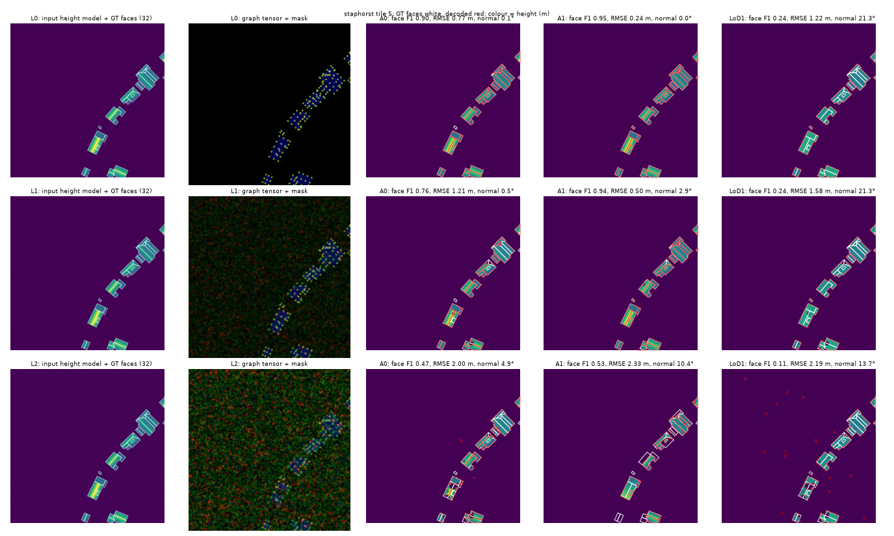
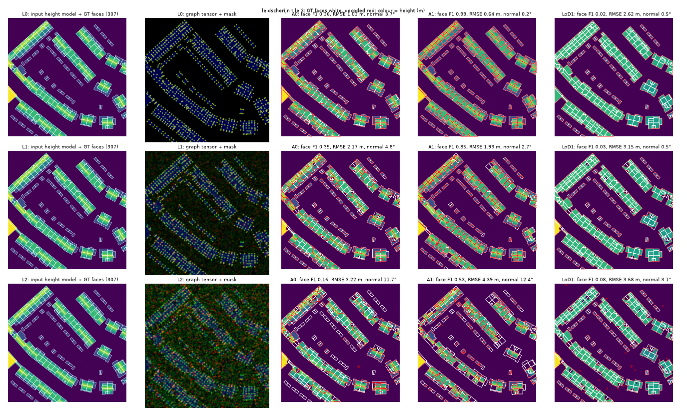

# E031: Oracle for LoD2 roofs: roof-edge graph vs height-model plane segmentation (pre-registered)

Status: **complete** (2026-10-27; CPU, 3.5 min test + 10 min tuning on 6 processes; code `7937eac`). **By the pre-registered rule the roof graph (A1) is not viable: it delineates roof faces far better than height-model plane segmentation (face F1 0.99 vs 0.48–0.62 clean, 0.55–0.58 vs 0.25–0.33 at level 2), but where its graph fails a building is left without a roof, so its height error is worse once corrupted, and the rule required heights within 0.05 m.**

Background: E028 found the Sat2Graph-style graph tensor decodes building footprints well (closed,
small planar graphs), and E030 is testing it trained. An LoD2 roof is the same kind of object: in
plan view a planar graph whose outer ring is the eaves and whose inner edges are ridges, hips,
valleys and step edges, with one plane per face. This oracle asks, before any training, whether
delineating roof faces with that graph beats the classic approach, which segments a height
model (DSM / LiDAR) into planar patches.

## Question
With perfect targets corrupted in controlled ways, does decoding roof faces from a roof-edge
graph tensor (A1) give better roof structure and heights than plane segmentation of the height
model (A0), when both get the same building mask and the same height model?

## Data
3DBAG v20250903 LoD2.2 ("© 3DBAG by tudelft3d and 3DGI", CC BY 4.0), CityJSON tiles fetched and
SHA-256-verified by `fetch_3dbag.py`, stored outside the repo. The LoD2.2 roofs are themselves
reconstructed automatically from AHN LiDAR (roofer), so they are model output, not survey truth;
here they only provide realistic roof geometry.

| area | role | 3DBAG tiles | buildings |
|---|---|---|---|
| delft | tune | 4 | 4,448 |
| leidscherijn | test (new-build suburb) | 4 | 6,632 |
| staphorst | test (village, farmhouses) | 1 | 1,145 |

Rasterized at **0.25 m** (Dutch aerial imagery) in 512² tiles (128 m) on a grid over each area;
tiles with fewer than 3 buildings are skipped; at most 40 tiles per area, chosen at random with
seed 0. Ground truth per tile: every RoofSurface projected to plan view and clipped to the tile;
faces under 1 m² are dropped; each face gets the least-squares plane of its 3D vertices. The
height model is the roof planes rasterized as height above the building's ground (GroundSurface
height), 0 outside buildings. The building mask is the union of the faces.

## Arms
Both get the same (corrupted) **building mask** and **height model**.

| id | roof faces from | then |
|---|---|---|
| A0 | the height model: smooth, per-pixel gradient, join 4-neighbours inside the mask whose gradients and heights agree, drop small regions, merge regions with near-identical planes, polygonize (`polygons_from_labels`) | robust (trimmed) least-squares plane per face |
| A1 | a graph tensor of the plan-view roof graph (`manyseg.vectors.graph_tensor` at the time, now `experiments/E030_whu_polygons/graph_tensor.py`; planar, 20 px spacing): `polygons_from_tensor` with faces kept inside the mask | same plane fit per face |
| LoD1 | the building mask (one face per connected component) | one flat height (median) | reference only |

## Corruptions
Graph tensor and mask: E028's levels (occlusion disks along roof edges, blur, correlated noise,
missed peaks, vector noise). Height model, per level: L0 none; L1 white noise 0.05 m; L2 0.15 m
plus blur σ 1 px; L3 0.3 m plus blur σ 2 px plus 2% of pixels lost (filled from the nearest
valid pixel). Five noise seeds per tile and level; the same draw for both arms.

## Tuning
Each arm's parameters (A0: smoothing, gradient and height tolerances, minimum region, merge
tolerance, simplify; A1: E030's B2 decoder grid) are tuned on **delft** at each level with seeds
0–1, at most 24 settings per arm, by face F1 × (1 − min(1, height RMSE / 1 m)); frozen for test.

## Metrics
Per tile, pooled per area: **face F1** (plan-view faces matched one-to-one at IoU > 0.5,
`polygon_metrics`), **height RMSE** (m; reconstructed roof surface vs ground truth over all
building pixels; a missing roof counts as height 0), corner F1 (face vertices matched within
0.5 m), C-IoU of matched faces, and normal angle error of matched faces (degrees).

## Decision rule (fixed before any result)
A1 **beats** A0 at a level if on both test areas its face F1 is higher by more than 2 pooled
seed-SDs and by at least 0.02, and its height RMSE is no more than 0.05 m worse. A1 is **viable**
if it is never more than 0.02 below A0 in face F1, nor more than 0.05 m worse in height RMSE, at
levels 0–2.
* A1 beats A0 at level 1 or 2 and is viable → a trained LoD2 experiment with roof-graph heads
  (imagery + height model in, roof graph + mask out) is worth running.
* A1 viable but never beats A0 → roof graphs are not worth a trained experiment by themselves;
  LoD2 uses plane segmentation of a height model, and ManySeg's part is the footprint.
* A1 not viable → as above, and the graph tensor is not used for roofs.

## Limits (stated in advance)
The corruptions are synthetic and independent between the graph and the height model, whereas
a trained network's graph errors would correlate with what the height model shows. The labels
come from an automatic LiDAR reconstruction. Dutch roofs only.

## Amendment 1 (2026-10-27 09:12, before tuning)
A 2-tile smoke run on delft (tuning data) showed the registered tuning objective,
face F1 × (1 − min(1, RMSE / 1 m)), is 0 for almost every setting: height RMSE is above 1 m even
for good decodes, because a pixel assigned to the wrong side of a step edge (often 10–20 m) and
uncovered pixels (height 0) dominate it. Tuning would then pick the first grid entry. The
objective is now **face F1 / (1 + RMSE in m)**, which never saturates. Metrics and decision rules
are unchanged. The aborted run was discarded.

## Results

Pooled over each test area's tiles (40 per area), mean ± SD over 5 noise seeds. Tuned parameters:
`runs/best.json` (A1 chose the lowest vertex threshold, 0.1, at every level: the grid edge again).

**face_f1**

| area | arm | L0 | L1 | L2 | L3 |
|---|---|---|---|---|---|
| leidscherijn | A0 | 0.479 ± 0.000 | 0.428 ± 0.008 | 0.252 ± 0.010 | 0.136 ± 0.004 |
| leidscherijn | A1 | 0.994 ± 0.000 | 0.871 ± 0.007 | 0.550 ± 0.009 | 0.055 ± 0.007 |
| leidscherijn | LoD1 | 0.114 ± 0.000 | 0.118 ± 0.002 | 0.084 ± 0.007 | 0.019 ± 0.001 |
| staphorst | A0 | 0.616 ± 0.000 | 0.548 ± 0.012 | 0.325 ± 0.008 | 0.151 ± 0.007 |
| staphorst | A1 | 0.993 ± 0.000 | 0.894 ± 0.002 | 0.576 ± 0.014 | 0.059 ± 0.004 |
| staphorst | LoD1 | 0.186 ± 0.000 | 0.175 ± 0.004 | 0.115 ± 0.004 | 0.023 ± 0.001 |

**h_rmse**

| area | arm | L0 | L1 | L2 | L3 |
|---|---|---|---|---|---|
| leidscherijn | A0 | 0.86 ± 0.00 | 1.44 ± 0.02 | 2.04 ± 0.05 | 2.81 ± 0.03 |
| leidscherijn | A1 | 0.36 ± 0.00 | 1.55 ± 0.04 | 4.01 ± 0.15 | 6.15 ± 0.03 |
| leidscherijn | LoD1 | 1.47 ± 0.00 | 1.86 ± 0.02 | 2.23 ± 0.05 | 2.94 ± 0.02 |
| staphorst | A0 | 0.78 ± 0.00 | 1.36 ± 0.01 | 1.92 ± 0.03 | 2.69 ± 0.07 |
| staphorst | A1 | 0.28 ± 0.00 | 1.80 ± 0.24 | 4.32 ± 0.11 | 6.42 ± 0.02 |
| staphorst | LoD1 | 1.28 ± 0.00 | 1.68 ± 0.01 | 2.05 ± 0.02 | 2.77 ± 0.04 |

**h_mae**

| area | arm | L0 | L1 | L2 | L3 |
|---|---|---|---|---|---|
| leidscherijn | A0 | 0.33 ± 0.00 | 0.58 ± 0.01 | 1.03 ± 0.03 | 1.60 ± 0.02 |
| leidscherijn | A1 | 0.03 ± 0.00 | 0.55 ± 0.06 | 2.83 ± 0.14 | 5.76 ± 0.05 |
| leidscherijn | LoD1 | 1.07 ± 0.00 | 1.24 ± 0.01 | 1.45 ± 0.04 | 1.95 ± 0.01 |
| staphorst | A0 | 0.22 ± 0.00 | 0.49 ± 0.02 | 0.91 ± 0.02 | 1.45 ± 0.04 |
| staphorst | A1 | 0.02 ± 0.00 | 0.77 ± 0.17 | 3.15 ± 0.09 | 6.06 ± 0.03 |
| staphorst | LoD1 | 0.81 ± 0.00 | 0.97 ± 0.00 | 1.16 ± 0.01 | 1.65 ± 0.02 |

**corner_f1**

| area | arm | L0 | L1 | L2 | L3 |
|---|---|---|---|---|---|
| leidscherijn | A0 | 0.554 ± 0.000 | 0.429 ± 0.002 | 0.232 ± 0.005 | 0.103 ± 0.001 |
| leidscherijn | A1 | 0.951 ± 0.000 | 0.793 ± 0.004 | 0.526 ± 0.007 | 0.110 ± 0.004 |
| leidscherijn | LoD1 | 0.497 ± 0.000 | 0.394 ± 0.001 | 0.215 ± 0.002 | 0.054 ± 0.001 |
| staphorst | A0 | 0.462 ± 0.000 | 0.379 ± 0.003 | 0.226 ± 0.004 | 0.095 ± 0.002 |
| staphorst | A1 | 0.951 ± 0.000 | 0.796 ± 0.005 | 0.529 ± 0.006 | 0.105 ± 0.007 |
| staphorst | LoD1 | 0.443 ± 0.000 | 0.362 ± 0.002 | 0.205 ± 0.004 | 0.048 ± 0.001 |

**normal_err_deg**

| area | arm | L0 | L1 | L2 | L3 |
|---|---|---|---|---|---|
| leidscherijn | A0 | 2.5 ± 0.0 | 2.9 ± 0.1 | 9.1 ± 0.6 | 14.8 ± 0.6 |
| leidscherijn | A1 | 0.1 ± 0.0 | 2.0 ± 0.2 | 12.0 ± 0.4 | 19.9 ± 1.5 |
| leidscherijn | LoD1 | 15.4 ± 0.0 | 14.3 ± 0.3 | 11.7 ± 0.8 | 11.7 ± 1.3 |
| staphorst | A0 | 1.6 ± 0.0 | 2.1 ± 0.2 | 7.5 ± 0.4 | 12.5 ± 0.4 |
| staphorst | A1 | 0.2 ± 0.0 | 1.4 ± 0.1 | 8.6 ± 0.3 | 17.1 ± 1.4 |
| staphorst | LoD1 | 12.3 ± 0.0 | 11.5 ± 0.8 | 9.9 ± 0.5 | 8.3 ± 0.8 |

**ciou**

| area | arm | L0 | L1 | L2 | L3 |
|---|---|---|---|---|---|
| leidscherijn | A0 | 0.662 ± 0.000 | 0.560 ± 0.005 | 0.405 ± 0.004 | 0.406 ± 0.005 |
| leidscherijn | A1 | 0.938 ± 0.000 | 0.829 ± 0.001 | 0.688 ± 0.004 | 0.553 ± 0.010 |
| leidscherijn | LoD1 | 0.633 ± 0.000 | 0.500 ± 0.005 | 0.368 ± 0.006 | 0.280 ± 0.012 |
| staphorst | A0 | 0.620 ± 0.000 | 0.517 ± 0.002 | 0.374 ± 0.007 | 0.391 ± 0.006 |
| staphorst | A1 | 0.938 ± 0.000 | 0.836 ± 0.004 | 0.708 ± 0.003 | 0.568 ± 0.016 |
| staphorst | LoD1 | 0.547 ± 0.000 | 0.434 ± 0.003 | 0.344 ± 0.002 | 0.252 ± 0.004 |

### Decision (pre-registered rule, applied by `analyze.py`)

* A1 beats A0 at: neither L1 nor L2; viable per level: {'L0': True, 'L1': False, 'L2': False}.
* → **not viable: plane segmentation for roofs; no graph tensor for roofs.**

## Interpretation
* **Roof structure: the graph is much better.** Face F1 0.99 vs 0.48 / 0.62 clean, 0.87–0.89 vs
  0.43–0.55 at level 1 and 0.55–0.58 vs 0.25–0.33 at level 2; corner F1 and C-IoU the same way;
  normals within 0.1–0.2° clean. Plane segmentation merges adjacent roof faces with similar slopes
  (whole terraces become one face) and splits faces under noise.
* **Heights: the graph is better clean, worse corrupted, and the rule follows height.** Clean,
  height MAE is 0.02–0.03 m vs 0.22–0.33 m (RMSE 0.28–0.36 vs 0.78–0.86 m). At levels 1–2 its RMSE
  is worse (level 2: 4.0–4.3 vs 1.9–2.0 m), because it fails all-or-nothing, as in E028 and as
  the figures show: a building whose graph does not close gets no roof, and its pixels count as
  height 0, while plane segmentation always covers the whole mask. The rule demanded heights
  within 0.05 m, so A1 is **not viable** at levels 1–2 and the registered consequence applies: no
  trained roof-graph experiment on this evidence.
* **The baseline is weak, which this result does not change but limits.** A0 is a simple
  region-growing segmentation, not a state-of-the-art LiDAR reconstruction (3DBAG's own labels come
  from roofer on clean AHN point clouds, which would do far better than A0 at level 0). Against a
  strong baseline A1's structural margin would shrink; its height failure would not.
* **What would fix the failure mode** (not tested, would need its own pre-registration): a hybrid
  that takes faces from the roof graph where it closes and falls back to plane segmentation (or an
  LoD1 block) elsewhere. It should keep the graph's faces and heights where the graph closes and
  avoid the uncovered buildings that drive A1's height error; whether it does is untested.
* LoD1 blocks: RMSE 1.3–1.5 m clean (2.0–2.2 at level 2), the floor that LoD2 is meant to beat.

## Next
LoD2 does not get a trained roof-graph experiment on this evidence. ManySeg's part of LoD2 stays
the footprint (E030) plus a height model as input, with roofs from plane segmentation; a
graph/segmentation hybrid is a candidate oracle (E031b) if LoD2 becomes a priority.

# E031b: roof graph with a plane-segmentation fallback (pre-registered 2026-10-27 10:20)

Suggested by the user after E031: one model with roof-graph heads and a building-mask head, the
height model as input; decode with the graph where it works and fall back to plane segmentation
where it does not. The fallback needs no extra head (A0 uses only the mask and the height model).

**Arm H (hybrid):** per building (4-connected component of the mask), compute the share of its
pixels covered by A1's faces whose representative point lies in it. If the share is at least
`cov`, the building takes A1's faces; otherwise it takes A0's faces. A0 and A1 run with their
frozen E031 parameters for that level (`runs/best.json`); only `cov` ∈ {0.7, 0.8, 0.9, 0.95} is
tuned on delft (seeds 0–1, same objective as E031 amendment 1). Test: same tiles, levels, seeds
and metrics as E031, with A0, A1 and H rerun together.

**Decision rule** (E031's, with H in A1's place): H beats A0 at a level if, on both test areas,
face F1 is higher by more than 2 pooled seed-SDs and at least 0.02 and height RMSE is no more
than 0.05 m worse; H is viable if never more than 0.02 below A0 in face F1 nor more than 0.05 m
worse in RMSE at levels 0–2. If H beats A0 at level 1 or 2 and is viable, a trained LoD2
experiment (imagery + height model in; roof graph + mask out; this hybrid decoder) is worth
running. Otherwise LoD2 stays with plane segmentation.

## E031b results

Status: **complete** (2026-10-27; code `e1c20c7`; tuned coverage threshold 0.7 at levels 0, 2, 3
and 0.9 at level 1, `runs/best_h.json`). Same tiles, seeds and metrics as E031; A0 and A1 rerun
with identical results.

**face_f1**

| area | arm | L0 | L1 | L2 | L3 |
|---|---|---|---|---|---|
| leidscherijn | A0 | 0.479 ± 0.000 | 0.428 ± 0.008 | 0.252 ± 0.010 | 0.136 ± 0.004 |
| leidscherijn | A1 | 0.994 ± 0.000 | 0.871 ± 0.007 | 0.550 ± 0.009 | 0.055 ± 0.007 |
| leidscherijn | H | 0.993 ± 0.000 | 0.796 ± 0.015 | 0.453 ± 0.016 | 0.137 ± 0.004 |
| staphorst | A0 | 0.616 ± 0.000 | 0.548 ± 0.012 | 0.325 ± 0.008 | 0.151 ± 0.007 |
| staphorst | A1 | 0.993 ± 0.000 | 0.894 ± 0.002 | 0.576 ± 0.014 | 0.059 ± 0.004 |
| staphorst | H | 0.995 ± 0.000 | 0.814 ± 0.015 | 0.478 ± 0.030 | 0.153 ± 0.007 |

**h_rmse**

| area | arm | L0 | L1 | L2 | L3 |
|---|---|---|---|---|---|
| leidscherijn | A0 | 0.86 ± 0.00 | 1.44 ± 0.02 | 2.04 ± 0.05 | 2.81 ± 0.03 |
| leidscherijn | A1 | 0.36 ± 0.00 | 1.55 ± 0.04 | 4.01 ± 0.15 | 6.15 ± 0.03 |
| leidscherijn | H | 0.34 ± 0.00 | 1.15 ± 0.03 | 2.08 ± 0.06 | 2.81 ± 0.03 |
| staphorst | A0 | 0.78 ± 0.00 | 1.36 ± 0.01 | 1.92 ± 0.03 | 2.69 ± 0.07 |
| staphorst | A1 | 0.28 ± 0.00 | 1.80 ± 0.24 | 4.32 ± 0.11 | 6.42 ± 0.02 |
| staphorst | H | 0.27 ± 0.00 | 1.10 ± 0.02 | 1.89 ± 0.03 | 2.69 ± 0.07 |

**h_mae**

| area | arm | L0 | L1 | L2 | L3 |
|---|---|---|---|---|---|
| leidscherijn | A0 | 0.33 ± 0.00 | 0.58 ± 0.01 | 1.03 ± 0.03 | 1.60 ± 0.02 |
| leidscherijn | A1 | 0.03 ± 0.00 | 0.55 ± 0.06 | 2.83 ± 0.14 | 5.76 ± 0.05 |
| leidscherijn | H | 0.03 ± 0.00 | 0.33 ± 0.02 | 1.02 ± 0.03 | 1.60 ± 0.02 |
| staphorst | A0 | 0.22 ± 0.00 | 0.49 ± 0.02 | 0.91 ± 0.02 | 1.45 ± 0.04 |
| staphorst | A1 | 0.02 ± 0.00 | 0.77 ± 0.17 | 3.15 ± 0.09 | 6.06 ± 0.03 |
| staphorst | H | 0.02 ± 0.00 | 0.29 ± 0.02 | 0.86 ± 0.01 | 1.45 ± 0.04 |

**corner_f1**

| area | arm | L0 | L1 | L2 | L3 |
|---|---|---|---|---|---|
| leidscherijn | A0 | 0.554 ± 0.000 | 0.429 ± 0.002 | 0.232 ± 0.005 | 0.103 ± 0.001 |
| leidscherijn | A1 | 0.951 ± 0.000 | 0.793 ± 0.004 | 0.526 ± 0.007 | 0.110 ± 0.004 |
| leidscherijn | H | 0.951 ± 0.000 | 0.661 ± 0.020 | 0.331 ± 0.007 | 0.103 ± 0.001 |
| staphorst | A0 | 0.462 ± 0.000 | 0.379 ± 0.003 | 0.226 ± 0.004 | 0.095 ± 0.002 |
| staphorst | A1 | 0.951 ± 0.000 | 0.796 ± 0.005 | 0.529 ± 0.006 | 0.105 ± 0.007 |
| staphorst | H | 0.952 ± 0.000 | 0.616 ± 0.020 | 0.309 ± 0.013 | 0.096 ± 0.002 |

**normal_err_deg**

| area | arm | L0 | L1 | L2 | L3 |
|---|---|---|---|---|---|
| leidscherijn | A0 | 2.5 ± 0.0 | 2.9 ± 0.1 | 9.1 ± 0.6 | 14.8 ± 0.6 |
| leidscherijn | A1 | 0.1 ± 0.0 | 2.0 ± 0.2 | 12.0 ± 0.4 | 19.9 ± 1.5 |
| leidscherijn | H | 0.1 ± 0.0 | 1.9 ± 0.3 | 10.9 ± 0.5 | 14.9 ± 0.6 |
| staphorst | A0 | 1.6 ± 0.0 | 2.1 ± 0.2 | 7.5 ± 0.4 | 12.5 ± 0.4 |
| staphorst | A1 | 0.2 ± 0.0 | 1.4 ± 0.1 | 8.6 ± 0.3 | 17.1 ± 1.4 |
| staphorst | H | 0.2 ± 0.0 | 1.5 ± 0.1 | 7.9 ± 0.5 | 12.6 ± 0.4 |

**ciou**

| area | arm | L0 | L1 | L2 | L3 |
|---|---|---|---|---|---|
| leidscherijn | A0 | 0.662 ± 0.000 | 0.560 ± 0.005 | 0.405 ± 0.004 | 0.406 ± 0.005 |
| leidscherijn | A1 | 0.938 ± 0.000 | 0.829 ± 0.001 | 0.688 ± 0.004 | 0.553 ± 0.010 |
| leidscherijn | H | 0.938 ± 0.000 | 0.803 ± 0.009 | 0.619 ± 0.005 | 0.408 ± 0.005 |
| staphorst | A0 | 0.620 ± 0.000 | 0.517 ± 0.002 | 0.374 ± 0.007 | 0.391 ± 0.006 |
| staphorst | A1 | 0.938 ± 0.000 | 0.836 ± 0.004 | 0.708 ± 0.003 | 0.568 ± 0.016 |
| staphorst | H | 0.938 ± 0.000 | 0.794 ± 0.010 | 0.601 ± 0.017 | 0.395 ± 0.008 |

### Decision (pre-registered rule, applied by `analyze.py`)

* H beats A0 at: ['L1', 'L2']; viable per level: {'L0': True, 'L1': True, 'L2': True}.
* → **a trained LoD2 experiment with roof-graph heads is worth running.**

### Interpretation
* **The hybrid passes: H beats A0 at levels 1 and 2 on both test areas and is viable at 0–2.**
  It keeps almost all of the roof graph's structure (face F1 0.99 clean; 0.80–0.81 vs 0.43–0.55
  at level 1; 0.45–0.48 vs 0.25–0.33 at level 2) and the fallback removes its height failure
  (RMSE 1.10–1.15 vs 1.36–1.44 m at level 1, 1.89–2.08 vs 1.92–2.04 m at level 2; MAE at least
  as good everywhere).
* At level 3 H equals A0 exactly: the graph covers no building well enough, so every building
  falls back. The fallback costs nothing when the graph fails.
* By the registered rule, **a trained LoD2 experiment is worth running**: imagery + height model
  in; roof-graph heads (vertex, edge, vector) + building mask out; this hybrid decoder. The
  E031 limits still apply (synthetic, independent corruptions; weak A0 relative to roofer).
