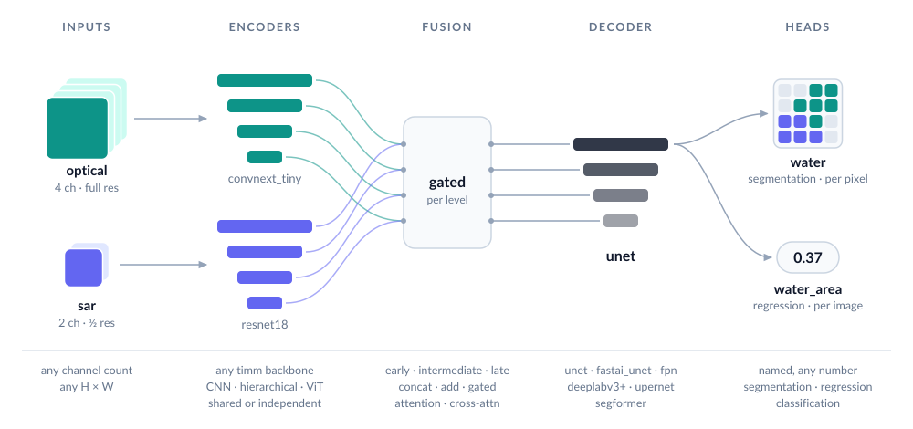
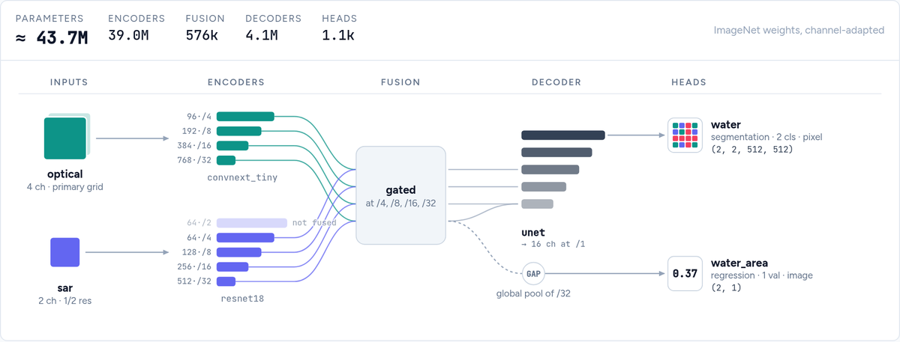

<!-- Generated from the repository README by scripts/sync_readme.py; edit that. -->
<p align="center">
  <picture>
    <source media="(prefers-color-scheme: dark)" srcset="https://raw.githubusercontent.com/DPIRD-DMA/ManySeg/main/docs/assets/logo-dark.svg">
    
  </picture>
</p>

<p align="center">
Segmentation and other dense-prediction models for PyTorch, built from
<a href="https://github.com/huggingface/pytorch-image-models">timm</a> encoders.<br>
Any number of bands, several inputs at different resolutions, metadata, and many outputs in one model.<br>
<a href="https://github.com/DPIRD-DMA/ManySeg/blob/main/docs/builder/">Model builder</a>: design a model in your browser and copy the code.
</p>

<p align="center">
  <picture>
    <source media="(prefers-color-scheme: dark)" srcset="https://raw.githubusercontent.com/DPIRD-DMA/ManySeg/main/docs/assets/architecture-dark.svg">
    
  </picture>
</p>

> **Status: alpha.** Before 1.0 the API may change between minor versions; every change is
> listed in [`CHANGELOG.md`](https://github.com/DPIRD-DMA/ManySeg/blob/main/CHANGELOG.md).

## Install

ManySeg is not on PyPI yet. Install it from GitHub (Python ≥ 3.10, PyTorch ≥ 2.10):

```bash
pip install "manyseg @ git+https://github.com/DPIRD-DMA/ManySeg#subdirectory=packages/manyseg"
```

Optional extras: `[quant]` (int8 quantisation), `[onnx]` (ONNX export), `[instances]`
(instance post-processing), `[vectors]` (polygons, road graphs and points as GIS layers).
After the first release this becomes `pip install manyseg`.

## Quick start

```python
import torch
from manyseg import create_model

model = create_model(backbone="convnext_tiny", in_channels=4, num_classes=3)  # U-Net by default
logits = model(torch.randn(2, 4, 257, 301))   # (2, 3, 257, 301): any size, odd or non-square
print(model.describe())                       # what was built, stage by stage
```

`backbone` is a timm model name: ResNet, EfficientNet, ConvNeXt, Swin, PVTv2, ViT, DINOv2 and
most other timm families that expose multi-scale features. 46 models are tested
([compatibility table](https://github.com/DPIRD-DMA/ManySeg/blob/main/docs/backbone_compatibility.md)); a few only accept inputs up to a fixed
size. Pretrained weights are the default (`pretrained=True`): timm downloads them on first use
and they are adapted to your band count. Pass `pretrained=False` to skip the download.

The model does not normalise its input: scale or standardise your bands as you would for any
timm model. Each pretrained weights saw RGB as `(x - mean) / std` with its own statistics:
ImageNet's for most, 0.5 / 0.5 for ViT AugReg and SigLIP, CLIP's for EVA-02. `describe()` and
`manyseg.weights.attribution(model)` show the values. With `num_classes=` the output is one
tensor of raw logits; with `heads=` it is a dict of raw logits keyed by head name.

## Model builder

Not sure how to combine inputs, fusion and heads? The [model builder](https://github.com/DPIRD-DMA/ManySeg/blob/main/docs/builder/) draws the
model as you pick options and writes the `create_model` call, refusing combinations ManySeg would
reject. In a clone of this repository, open `docs/builder/index.html` in a browser; it needs no
server.

<a href="https://github.com/DPIRD-DMA/ManySeg/blob/main/docs/builder/"><picture>
  <source media="(prefers-color-scheme: dark)" srcset="https://raw.githubusercontent.com/DPIRD-DMA/ManySeg/main/docs/assets/builder-dark.png">
  
</picture></a>

## Common tasks

**Multispectral imagery.** Set `in_channels` (e.g. 13 for Sentinel-2). The pretrained RGB stem
is adapted automatically. For extra channels that are not image bands (validity masks, quality
flags), use `channel_adapter="rgb_plus_zero"`. If bands can be missing at inference, fill them
the way you did in training and drop bands at random while training
([missing bands](https://github.com/DPIRD-DMA/ManySeg/blob/main/docs/api_design.md#missing-bands)).

**Pick a speed/accuracy trade-off.** Presets are measured configurations:

```python
from manyseg.presets import preset

model = create_model(**preset("balanced"), in_channels=4, num_classes=2)
```

| preset | encoder + decoder | relative speed | accuracy |
|---|---|---|---|
| `fast` | PVTv2-b0 + SegFormer head | 2.4× | slightly below the default on Pet |
| `compact` | PVTv2-b0 + quarter-width U-Net | 2.2× | matches or beats the default |
| `balanced` | PVTv2-b0 + half-width U-Net | 2.1× | matches or beats the default |
| `accurate` | PVTv2-b0 + U-Net | 1.5× | matches or beats the default |

Relative to the default ResNet-34 U-Net, on an RTX 4090 with bf16 + `torch.compile`; accuracy
on two datasets. Validate on your own data. On CPU the speed-up disappears: with fp32, one
1024² tile and 16 threads, the presets ran at 0.48–0.60 s compiled against the default's 0.58 s,
and 0.58–0.84 s eager against 0.62 s (`PRESETS[name].measured["cpu_s"]`; one run on one machine,
not recorded in `experiments/`), although the default has 2.5–6.5× their FLOPs. For CPU
inference, time your candidates on the target machine, eager and compiled separately.

**Several inputs, possibly at different resolutions**, e.g. optical + radar:

```python
model = create_model(
    inputs={
        "optical": {"in_channels": 4, "backbone": "convnext_tiny"},
        "sar": {"in_channels": 2, "backbone": "resnet18", "alignment": "same_extent"},  # half res OK
    },
    fusion={"type": "intermediate", "op": "concat"},
    num_classes=2,
)
out = model({"optical": optical, "sar": sar})
```

**Several outputs.** Name your heads; the model returns a dict:

```python
model = create_model(
    backbone="resnet50", in_channels=4,
    heads={
        "landcover": {"type": "segmentation", "out_channels": 8},
        "height":    {"type": "regression", "out_channels": 1},                  # per pixel
        "flooded":   {"type": "classification", "out_channels": 2, "scope": "image"},
    },
)
```

A pixel head is one 3×3 conv, as in SMP. For a wider one, give it hidden layers, e.g.
`"hidden": [64, 32, 16], "dilation": [8, 16, 32]` for a receptive field that matches large
objects. Any head can also get its own decoder (`"decoder": "unet"`), or be your own class
registered with `manyseg.heads.HEADS.register("name")`.

**Training.** A model is a plain `nn.Module`, so any trainer works. There are examples for
[fastai](https://github.com/DPIRD-DMA/ManySeg/blob/main/examples/09_fastai.py), a [plain PyTorch loop](https://github.com/DPIRD-DMA/ManySeg/blob/main/examples/10_pytorch.py),
[Lightning](https://github.com/DPIRD-DMA/ManySeg/blob/main/examples/11_lightning.py), [Accelerate](https://github.com/DPIRD-DMA/ManySeg/blob/main/examples/12_accelerate.py) and
[TorchGeo](https://github.com/DPIRD-DMA/ManySeg/blob/main/examples/13_torchgeo.py) (its segmentation task with a ManySeg model), all tested
in CI. With several heads, a loss and metrics read the dict (`out["landcover"]`), or
`manyseg.utils.concat_heads(model, ["landcover", "height"])` wraps the model so it returns one
concatenated tensor, for code that wants one. `manyseg.losses` has the losses our benchmarks
train with (Dice + BCE,
multi-class Dice, masked regression, CenterNet heatmap focal loss) as plain functions, and
`multi_head_loss` sums a weighted loss per head of the output dict.
A model with metadata inputs takes a dict, so a loop that passes one tensor needs a small
wrapper of your own that builds it. Save the model inside, not the wrapper
(`manyseg.save(wrapper.model, ...)`), and wrap `manyseg.load(path)` again after loading.

**Image classification or regression.** Use only image heads: no decoder is built, and the
model is a classifier that still accepts several inputs, metadata and extra heads.

```python
model = create_model(backbone="resnet50", in_channels=12, heads={
    "labels": {"type": "classification", "out_channels": 19, "scope": "image"}})
```

If you also have pixel labels, training with an extra segmentation head can improve the
classifier. Drop it before deployment with `model.select_heads(["labels"])` (in place: the
model keeps only that head and its output stays a dict).

**Metadata** (acquisition date, sun angle, location, sensor) as extra inputs:

```python
inputs = {
    "image": {"in_channels": 4},
    "meta": {"kind": "vector", "fields": {"doy": {"type": "cyclic", "period": 365.25},
                                          "latlon": {"type": "coords"}}},  # degrees, lat first
}
model = create_model(inputs=inputs, num_classes=2)
meta = model.pack_metadata("meta", {"doy": torch.tensor([45.0, float("nan")]),  # NaN = missing
                                    "latlon": torch.tensor([[-31.9, 115.9], [-33.9, 18.4]])})
out = model({"image": torch.randn(2, 4, 128, 128), "meta": meta})
```

The model takes the packed `(B, N)` tensor; `pack_metadata` builds it from per-field values,
and NaN marks a missing value. In our tests metadata rarely helped, so compare against a model
without it on your data.

**Time series.** One encoder runs on every date and the dates are combined per level (mean,
max, attention, ...); pass `(B, T, C, H, W)` plus optional `"s2_mask"` / `"s2_dates"`:

```python
model = create_model(inputs={"s2": {"kind": "timeseries", "in_channels": 10}}, num_classes=20)
out = model({"s2": torch.randn(2, 6, 10, 128, 128)})        # any number of dates
```

**Change detection.** Two dates through one shared (Siamese) encoder, a difference fusion,
and optionally a land-cover head per date (semantic change):

```python
model = create_model(
    inputs={"t1": {"in_channels": 3},
            "t2": {"in_channels": 3, "backbone": "shared:t1", "share_norm": True}},
    fusion={"type": "intermediate", "op": "diff"},
    heads={"change": {"type": "segmentation", "out_channels": 2},
           "lc1": {"type": "segmentation", "out_channels": 7, "input": "t1"},
           "lc2": {"type": "segmentation", "out_channels": 7, "input": "t2", "share": "lc1"}},
)
```

**Overlapping classes** (e.g. cloud and shadow): one segmentation head with a channel per
class, a sigmoid per channel and BCE loss.

**Embeddings.** `model.features(x)` returns the encoder pyramid; `model.embed(x,
pool="mean")` gives vectors for retrieval, clustering or probing.

**Remote-sensing pretrained weights.** `create_model(backbone="resnet50",
pretrained="ssl4eo_s2_dino", in_channels=13, ...)` loads SSL4EO-S12 weights
(Sentinel-2 MoCo: ResNet-18/50, ViT-S/16; DINO: ResNet-50, ViT-S/16; Sentinel-1 MoCo:
ResNet-50) or SatlasPretrain Sentinel-2 weights (ResNet-50/152); `manyseg.weights.WEIGHTS` lists the band order and normalisation each
expects. Fed their own pretraining normalisation, SSL4EO DINO weights beat the ImageNet
baseline on all three Sentinel-2 datasets we tested (ResNet-50, full fine-tuning; E024).
The weights are CC BY 4.0 / ODC-BY and need attribution, also once fine-tuned: saved models
record each pretrained backbone's licence and citation, and `describe()` lists them.

**Objects and counts.** `manyseg.instances` (touching fields, crowns, buildings) and
`manyseg.points` (trees, animals: centres, counts) provide the heads, training targets (from
instance masks, points or YOLO / COCO boxes) and post-processing; the losses are in
`manyseg.losses`, plus `density_loss` in `manyseg.points`. To count, either
find peaks in a centre heatmap (`find_peaks`, with optional smoothing and a foreground mask)
or sum a density map (`density_head`, `density_loss`). Which is better depends on the data.
With many small trees per tile, the density head had half the count error of peaks at a fixed
threshold (E011), and about the same once the threshold was calibrated on validation data (test
MAE 19.4 against 20.6; E011b). With a few large plants per drone tile, peak counting was far
better (count MAE 1.0 against 7.5–11 for raw density heads), because a small background bias
summed over every pixel adds up; count peaks for a few large objects. `density_head()` uses a
softplus output by default: on that drone data its count MAE was 2.9, against 10.1 for the raw
head clamped at 0 and 7.5 summed as is, and on OAM-TCD it was no worse than the raw head (E011c).
Softplus never reaches 0, so a mostly empty tile still sums to a small positive count (about 2
objects on an empty 792 x 792 drone tile); `density_head(activation=None)` gives the raw head.
The drone numbers come from one downstream dataset (45 validation images, one seed) and are not
reproduced in this repository. Validate on your data.

**Vector outputs (experimental).** `manyseg.vectors` (the `[vectors]` extra) turns
predictions into GIS layers: building footprints with straight walls, field boundaries,
road graphs with junctions and overpasses, LoD2 roof faces with a plane and 3-D mesh each
(heights from an nDSM input), and points. Each task has a head preset, target encoders that
work in pixel coordinates (`to_pixels` brings your vector labels there from any CRS), and a
decoder tested in experiments (`docs/api_design.md` gives each one's evidence). One call decodes
a scene of any size: large scenes block by block, with the default 256 px halo. `min_halo` is
only the smallest halo a decoder accepts and doesn't guarantee the same result as a whole-scene
decode: on noise-like field predictions, halos up to 64 px gave different objects. An instance
reaching much further than the halo can split at a block seam, and for roads the halo must also
cover the skeleton's data-dependent reach (the decoder warns). With ManyPred this happens while
it predicts (needs ManyPred's first release).

```python
from manyseg.vectors import Scene, block_decoder, decode_scene

# probs: head name -> the stitched predictions (numpy; sigmoid on the logit heads)
scene = Scene(H, W, transform=src.transform, crs=src.crs)  # the image's grid (rasterio)
records = decode_scene(probs, block_decoder("footprints"), scene=scene)  # 4096 px blocks
records.write("buildings.geojson")  # polygons in the raster's CRS; .gpkg also needs geopandas
```

Examples [14–18](https://github.com/DPIRD-DMA/ManySeg/blob/main/examples/README.md) cover each task from vector labels to GeoJSON; the
[guide](https://github.com/DPIRD-DMA/ManySeg/blob/main/docs/api_design.md#vector-outputs-line-graphs-polygons) lists the heads, decoders,
evidence and limits.

**Save and load.** `manyseg.save` stores the weights with the configuration and, as metadata
for inference code, the input normalisation, output activations and class names; `manyseg.load`
rebuilds the model without downloading anything:

```python
import manyseg

model = manyseg.create_model(in_channels=4, num_classes=2)  # ... then train it
manyseg.save(model, "model.safetensors",
             activations={"logits": "softmax"},             # how each head becomes a prediction
             normalize=[{"type": "scale", "value": 10000}],  # the input scaling you trained with
             classes=["background", "water"])
model = manyseg.load("model.safetensors")
meta = manyseg.read_metadata("model.safetensors")  # the stored normalize / activations / classes
```

The loaded model still takes the raw-scale input you trained on and returns logits: applying
the stored normalisation and activations is up to the inference code. The default head of a
`num_classes=` model is named `"logits"`.

**Share on the Hugging Face Hub.** `manyseg.push_to_hub` takes the same arguments as `save`,
uploads the file to a model repository (private by default) and writes a model card listing
the inputs, heads and the licences of the pretrained weights. `load` and `read_metadata` take
Hub names as timm does:

```python
manyseg.push_to_hub(model, "your-org/water", activations={"logits": "softmax"},
                    normalize=[{"type": "scale", "value": 10000}], license="mit",
                    revision="v1")                  # optional: a branch name, created if needed
model = manyseg.load("hf-hub:your-org/water@v1")   # token=... for a private repository
```

Both use `HF_TOKEN` or a stored `hf auth login` when no `token=` is given. Tags and commits
can be loaded (`@<tag>`, `@<sha>`) but not pushed to.

Don't save the whole model with `torch.save(model)`: that pickle refers to ManySeg's internal
module paths, so it breaks when a later version moves or renames a class, and loading it
needs `torch.load(weights_only=False)`, which can run arbitrary code. A `manyseg.save` file holds
plain data: the `create_model` arguments, a save-format number and the weights. Files from an
older format are migrated on load, and a file from a newer ManySeg fails with both versions
named. A library that keeps its own table of models (architecture names plus weights) should
store one `manyseg.save` file per model and call `manyseg.load`; take
`manyseg.load(path).state_dict()` if it needs a state dict.

**Deployment.** Models work with `torch.compile(dynamic=True)`, `torch.export` and ONNX with
dynamic input sizes (a few encoder families only run at a fixed size or cannot export
dynamically; see the [compatibility table](https://github.com/DPIRD-DMA/ManySeg/blob/main/docs/backbone_compatibility.md)), and with int8
quantisation (`import manyseg.quantize`). For fast GPU inference use bf16
autocast plus `torch.compile`.

`manyseg.save` and `manyseg.load` also handle quantised models, with their metadata and
`tiling_spec()`, so ManyPred can run them from a file (both need `manyseg[quant]` to load):

```python
q = quantize_weights(model)                 # CPU or GPU: an nn.Module with int8 weights
manyseg.save(q, "model_int8.safetensors", normalize=spec, activations={"logits": "softmax"})

ep = quantize_pt2e(model, example, batches)  # CPU: static int8
manyseg.save(ep, "model_int8.pt2", source=model, normalize=spec,
             activations={"logits": "softmax"})
program = manyseg.load("model_int8.pt2")     # a callable with tiling_spec(), not an nn.Module
```

Only load `.pt2` files from sources you trust. `manyseg.load` refuses the ways we know a crafted
file could run code while loading, but that is not a sandbox, and the program runs when called.

Most of these have a runnable script in [`examples/`](https://github.com/DPIRD-DMA/ManySeg/blob/main/examples/) that runs on CPU: the numbered
scripts in a few seconds (5–15 s for 09–13, which train two short epochs), the walkthroughs that
train briefly in 10–20 s.

## Large images with ManyPred

A ManySeg model predicts a whole image in one forward pass, so memory limits the image size,
and a fixed-size backbone refuses anything larger than its size. For larger scenes use
[ManyPred](https://github.com/DPIRD-DMA/ManyPred), our tiled inference library: it predicts
overlapping patches in batches, stitches them, skips nodata, and reads and writes GeoTIFFs
larger than memory. It is a separate library so it can run any PyTorch model that returns a
tensor or a dict of tensors; ManySeg does not import it. Like ManySeg, it is not on PyPI yet
(`[geo]` adds rasterio for GeoTIFFs):

```bash
pip install "manypred[geo] @ git+https://github.com/DPIRD-DMA/ManyPred"
```

ManyPred reads the model's `tiling_spec()` (padding multiple, fixed input size, each head's
resolution) and the normalisation and activations stored by `manyseg.save`, so with a model
saved as in "Save and load" above neither is repeated:

```python
import numpy as np
import manyseg
from manypred import predict_array, predict_files
from manypred.geo import RasterioReader

model = manyseg.load("model.safetensors")
scene = np.random.randint(0, 10000, (4, 3000, 3000), dtype=np.uint16)  # raw scale, (C, H, W)
probs = predict_array(model, scene, patch_size=1024, overlap=256)  # (2, 3000, 3000), softmax

def load(path):  # patches are read as needed, so the scene can be larger than memory
    reader = RasterioReader(path)
    return reader, reader.profile  # the profile georeferences the output

# GeoTIFFs in, GeoTIFFs out (predictions/scene_pred.tif); nodata=0 skips zero-filled borders
predict_files(model, ["scene.tif"], load_func=load, output_dir="predictions",
              patch_size=1024, overlap=256, output="argmax", nodata=0)
```

`device` defaults to CUDA, then MPS, then the CPU, and `dtype` to float16 on GPUs where it is
fast (float32 elsewhere). Overlapping patches are blended by default (`merge="blend"`, a
weighted mean that fades towards each patch edge).
`merge="cut"` takes each pixel from the patch it is most central in, so nothing is averaged;
it can be set per head (`merge={"extent": "cut"}`). Use it for road heads decoded into graphs,
and keep blend for maps used as rasters. On City-Scale roads, blending lost junctions where
patches overlapped (junction agreement with a whole-scene pass 0.954, cut 0.971, away from
overlaps 0.972; E050). For roof faces patch size mattered more: agreement 0.945 (blend) or 0.944
(cut) with 512 px patches and 128 px overlap, and 0.979 (blend) or 0.987 (cut) with 1024 px
patches and 256 px overlap, a gain for cut that wasn't the pre-registered comparison (E050b;
[both experiments](https://github.com/DPIRD-DMA/ManySeg/blob/main/experiments/E050_stitching/README.md)). Cut and blend haven't been compared
on trained field or footprint models.

The vector decoders (**Vector outputs** above) run on large scenes through `manypred.blocks`:
`postprocess_blocks` decodes saved rasters block by block, and
`predict_files(..., merge="cut", block_postprocess=BlockPostprocess(...))` decodes while it
predicts ([guide](https://github.com/DPIRD-DMA/ManySeg/blob/main/docs/api_design.md#vector-outputs-line-graphs-polygons)). `merge` and
`manypred.blocks` are on ManyPred's GitHub main since 2026-11-02, and will be in its first
release.

ManyPred moves a model to its device and `dtype` in place and sets it to eval mode, and on GPUs
the default `dtype` is usually float16. So after a preview during training, reload the model or
restore your checkpoint before training further or calling `manyseg.save`, or run the preview on
a copy: otherwise the weights go on, and are saved, in the lower precision.

## Tips from our benchmarks

* **Small batches** (measured at 2 per GPU): keep the encoder's BatchNorm layers in eval mode during
  training (frozen running statistics; their weights still train;
  [recipe](https://github.com/DPIRD-DMA/ManySeg/blob/main/docs/api_design.md#small-batches)).
* **Memory-bound?** `decoder_kwargs={"out_stride": 2}` costs no accuracy for the U-Net and
  saves 11–18% memory. `model.set_grad_checkpointing()` recomputes encoder activations in
  the backward pass: same values, −22% memory for +5% step time on the ResNet-34 U-Net,
  −61% for +18% on ConvNeXt-T (E026).
* **Batch-1 inference:** `torch.compile(model, mode="reduce-overhead")` (CUDA graphs, fixed
  input size) is up to 1.8× faster than the default compile for the PVTv2-b0 presets (E026).
* **Water and other per-pixel spectral targets:** `decoder_kwargs={"input_cross": True}`
  feeds the raw bands to the last decoder stage. It did not help pet or cloud segmentation.
* **Mixed precision is safe:** bf16, fp16 and int8 weight-only showed no accuracy loss.
* **Training speed:** the default U-Net trains as fast as SMP's `Unet` on the same timm
  encoder: compiled steps match it, and eager steps are 18–25% faster (bf16, E025).
* **Fusion:** stacking all bands (optical and SAR) into one input matched the fancier fusion
  options on Sen1Floods11 (E005); start there. Splitting Sentinel-2 bands into resolution groups
  helped on one of the four datasets we tried (E015; not E016, E017 or E020).
* **Several dates** beat one by a wide margin. Stacking dates as channels is a strong baseline;
  the time-series input (`"kind": "timeseries"`) with `"temporal": "attention"` beat it on field
  delineation (the default masked mean fell just short) but not on crop types, so try both (E021).
* **Change detection:** a Siamese encoder (shared weights per date) with a difference fusion
  (`"op": "diff"` or `"concat_diff"`) beat stacking the two dates on both datasets we tried.

These come from experiments in [`experiments/`](https://github.com/DPIRD-DMA/ManySeg/blob/main/experiments/), where negative results are kept
too. Most are pre-registered and multi-seed; the speed and memory figures (E025, E026) are timing
runs without seeds.

## Documentation

* [`docs/builder/`](https://github.com/DPIRD-DMA/ManySeg/blob/main/docs/builder/): the model builder, a page where you pick inputs, encoders,
  fusion, decoder and heads and get a live diagram plus the `create_model` code. In a clone of
  this repository, open `docs/builder/index.html` in a browser; it needs no server.
* [`notebooks/`](https://github.com/DPIRD-DMA/ManySeg/blob/main/notebooks/): walkthroughs with real data and figures: flood mapping, radar plus
  optical with several outputs, and one notebook for each vector output.
* [`examples/`](https://github.com/DPIRD-DMA/ManySeg/blob/main/examples/): runnable scripts for most of the tasks above.
* [`docs/api_design.md`](https://github.com/DPIRD-DMA/ManySeg/blob/main/docs/api_design.md): the full API (inputs, fusion, decoders, heads,
  metadata, resolution, export, quantisation).
* [`experiments/`](https://github.com/DPIRD-DMA/ManySeg/blob/main/experiments/): the evidence behind the defaults and tips.
* [`CHANGELOG.md`](https://github.com/DPIRD-DMA/ManySeg/blob/main/CHANGELOG.md): what each release contains and what changed.

## Benchmarking (`manyseg-bench`)

A separate package for comparing segmentation libraries (ManySeg, segmentation_models_pytorch,
fastai, timm) under identical data, augmentation and training.
It is not published; install it from a clone of this repository (`uv sync`, or
`pip install -e packages/manyseg-bench`).
See [`docs/benchmark_design.md`](https://github.com/DPIRD-DMA/ManySeg/blob/main/docs/benchmark_design.md).

## Contributing

```bash
uv sync --all-packages
uv run pytest packages/manyseg -n 4            # fast tests
uv run pytest packages/manyseg -m slow -n 4    # compile, export, ONNX
```

See [`CONTRIBUTING.md`](https://github.com/DPIRD-DMA/ManySeg/blob/main/CONTRIBUTING.md), [`docs/roadmap.md`](https://github.com/DPIRD-DMA/ManySeg/blob/main/docs/roadmap.md) and
[`docs/testing_strategy.md`](https://github.com/DPIRD-DMA/ManySeg/blob/main/docs/testing_strategy.md).

## License

MIT. Designs ported from other libraries (e.g. the fastai-style U-Net) cite their source in
the code; see [`docs/architecture_review.md`](https://github.com/DPIRD-DMA/ManySeg/blob/main/docs/architecture_review.md).
